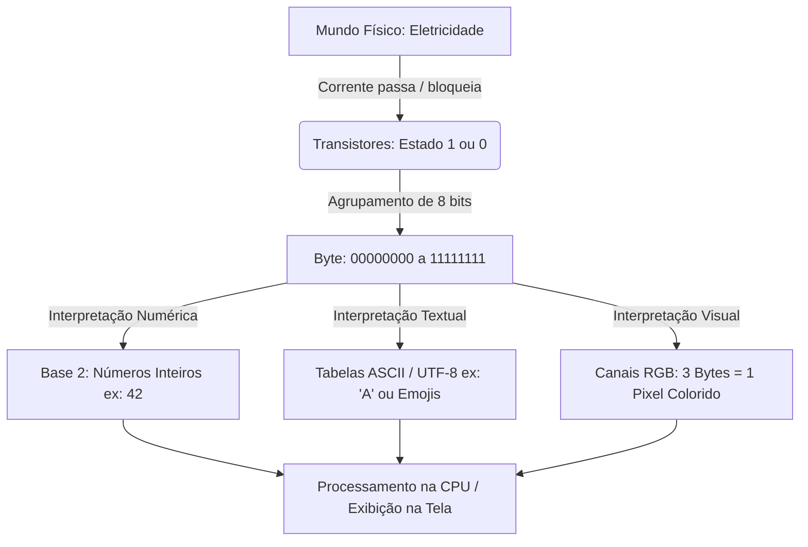

# Fundamentos da Computação: Transistores, Sistema Binário e Codificação

Compreender o funcionamento do computador em baixo nível é um dos principais diferenciais para um Desenvolvedor Júnior no mercado de trabalho. Em um cenário onde frameworks e abstrações de alto nível dominam o dia a dia, o profissional que entende o que acontece "por baixo dos panos" possui maior capacidade para diagnosticar problemas complexos, otimizar o uso de memória e compreender a eficiência de estruturas de dados e algoritmos.

---

## 1. Por que o Computador Usa Transistores e Sistema Binário?

### O Mundo Físico da Máquina e os Transistores
Diferente da mente humana, que raciocina em conceitos abstratos, o computador é uma máquina eletromecânica. Tudo o que processamos — programas, vídeos, áudios e textos — é reduzido a sinal elétrico.

No centro dessa estrutura está o **transistor**: um componente semicondutor microscópico que atua como uma chave eletrônica de altíssima velocidade. 
* **Transistor Ligado:** Permite a passagem de corrente elétrica $\rightarrow$ Representado pelo valor **$1$**.
* **Transistor Desligado:** Bloqueia a passagem de corrente elétrica $\rightarrow$ Representado pelo valor **$0$**.

Um processador moderno (CPU) contém bilhões desses transistores gravados em um chip de silício, alternando entre ligado e desligado bilhões de vezes por segundo.

```
       [ Corrente Elétrica ]
                │
        ┌───────┴───────┐
        │  TRANSISTOR   │
        └───────┬───────┘
          │           │
     (Passa)     (Não Passa)
          │           │
        ▼           ▼
     Bit = 1     Bit = 0
```

---

### O que é um Bit (Binary Digit)?
O **Bit** (abreviação de *Binary Digit*) é a **menor unidade de informação possível** em um sistema computacional. Ele só pode assumir dois estados distintos: **$0$** ou **$1$**.

> **Analogia do Interruptor:** Pense no bit como um interruptor de lâmpada simples da sua casa. Ele não aceita meio-termo: ou está desligado ($0$), ou está ligado ($1$).

---

### O que é um Byte?
Trabalhar isoladamente com bits seria extremamente limitado. Para representar informações mais complexas, os bits são agrupados. 

Um **Byte** é um grupo padronizado de **$8$ bits** trabalhando em conjunto. 

Com $8$ posições binárias, o número total de combinações possíveis é calculado por potências de base $2$:

$$2^8 = 256 \text{ combinações possíveis (de } 0 \text{ a } 255\text{)}$$

#### Múltiplos de Bytes na Prática
À medida que os arquivos e a memória cresceram em volume, passamos a utilizar prefixos para medir grandezas maiores:

| Unidade | Equivalência Aproximada | Equivalência Exata (Bytes) | Exemplo de Aplicação |
| :--- | :--- | :--- | :--- |
| **Byte (B)** | $8$ bits | $1 \text{ Byte}$ | Um único caractere (ASCII) |
| **Kilobyte (KB)** | $\approx 1.000$ Bytes | $1.024 \text{ Bytes } (2^{10})$ | Um documento de texto simples |
| **Megabyte (MB)** | $\approx 1 \text{ milhão de Bytes}$ | $1.048.576 \text{ Bytes } (2^{20})$ | Uma música em MP3 |
| **Gigabyte (GB)** | $\approx 1 \text{ bilhão de Bytes}$ | $1.073.741.824 \text{ Bytes } (2^{30})$ | Memória RAM ou um filme HD |
| **Terabyte (TB)** | $\approx 1 \text{ trilhão de Bytes}$ | $1.099.511.627.776 \text{ Bytes } (2^{40})$ | Disco Rígido (SSD/HD) |

---

### Por que não o Sistema Decimal (Base 10) no Hardware?
Uma dúvida comum é: *Se os humanos usam a base 10 (algarismos de $0$ a $9$), por que não construímos computadores que utilizam 10 níveis de voltagem elétrica para representar diretamente o sistema decimal?*

A resposta técnica é: **Tolerância ao Ruído e Confiabilidade Elétrica.**

Se um circuito precisasse diferenciar $10$ níveis de voltagem em uma escala de $0\text{V}$ a $5\text{V}$, cada nível teria uma variação mínima de apenas $0{,}5\text{V}$:

$$0\text{V} = 0, \quad 0{,}5\text{V} = 1, \quad 1{,}0\text{V} = 2, \quad \dots \quad 4{,}5\text{V} = 9$$

Pequenas flutuações de energia, interferência eletromagnética ou calor na placa-mãe facilmente fariam um sinal de $1{,}0\text{V}$ oscilar para $1{,}2\text{V}$ ou $0{,}8\text{V}$, corrompendo os dados (o computador não saberia se o valor é $1$, $2$ ou um erro).

No **Sistema Binário**, precisamos apenas de dois estados distantes e seguros:
* **Qualquer voltagem entre $0\text{V}$ e $0{,}8\text{V}$** é interpretada como **$0$**.
* **Qualquer voltagem entre $2{,}0\text{V}$ e $5\text{V}$** é interpretada como **$1$**.

Existe uma grande "margem de segurança" no meio. O sistema binário garante extrema estabilidade: mesmo sob interferência ou aquecimento, a máquina raramente erra a leitura de um bit.

> **Analogia do Dimmer vs. Interruptor:** Imagine tentar ajustar uma lâmpada com botão rotativo (*dimmer*) exatamente na intensidade $47\%$. Qualquer toque acidental muda o nível. Agora imagine um interruptor comum: ou está aceso ou apagado. O interruptor binário é infinitamente mais confiável e simples de operar em alta velocidade.

---

## 2. Como Letras, Cores e Números viram Binário?

Como o computador trabalha exclusivamente com $0$ e $1$, qualquer outro tipo de dado (números decimais, texto, imagem ou áudio) precisa passar por um processo de **codificação e abstração**.

---

### Representação de Números Inteiros (Base 2)
No sistema decimal (base 10), cada posição representa uma potência de $10$ ($10^0, 10^1, 10^2, \dots$). No **sistema binário (base 2)**, cada posição representa uma potência de $2$ ($2^0, 2^1, 2^2, 2^3, \dots$).

#### Exemplo 1: O número $5$ em Binário
Para formar o número $5$, somamos as potências de $2$ necessárias ($4 + 1$):

$$\text{Posição da potência de 2: } 2^2 \, (4) \quad 2^1 \, (2) \quad 2^0 \, (1)$$

$$\text{Valores dos bits: } 1 \quad 0 \quad 1$$

$$\text{Cálculo: } (1 \cdot 4) + (0 \cdot 2) + (1 \cdot 1) = 4 + 0 + 1 = 5$$

Portanto, o número decimal $5$ em binário de $8$ bits é **`00000101`**.

#### Exemplo 2: O número $42$ em Binário
Para formar o número $42$, somamos as potências $32 + 8 + 2$:

$$\text{Potências de 2: } 2^5 \, (32) \quad 2^4 \, (16) \quad 2^3 \, (8) \quad 2^2 \, (4) \quad 2^1 \, (2) \quad 2^0 \, (1)$$

$$\text{Valores dos bits: } 1 \quad 0 \quad 1 \quad 0 \quad 1 \quad 0$$

$$\text{Cálculo: } 32 + 0 + 8 + 0 + 2 + 0 = 42$$

Portanto, o número $42$ em binário de $8$ bits é **`00001010`** (ou **`00101010`** em $8$ bits completos).

---

### Textos e Caracteres: ASCII vs. Unicode/UTF-8
Se a memória só guarda números, como representamos letras como **A** ou um emoji como 🚀? A resposta é o uso de **Tabelas de Mapeamento (Character Sets)**.

```
Caractere ──> Tabela de Tradução ──> Código Numérico ──> Binário
   'A'     ──>     ASCII          ──>       65        ──> 01000001
```

#### 1. Tabela ASCII (American Standard Code for Information Interchange)
Criada nos anos 1960, a tabela ASCII mapeou os caracteres da língua inglesa utilizando **$7$ bits** (frequentemente armazenados em $1$ byte, deixando o $8^\text{o}$ bit livre).

* Permite $2^7 = 128$ símbolos (números $0-9$, letras $A-Z$, $a-z$ e caracteres de controle).
* **Exemplo:** A letra **`A`** equivale ao número decimal **$65$**, que em binário é **`01000001`**.
* **Limitação:** Não suporta acentuação (como `á`, `ç`, `ã`), nem outros alfabetos (cirílico, japonês, árabe).

#### 2. Unicode: O Catálogo Universal
Para resolver a limitação do ASCII, foi criado o **Unicode**. Ele não é um formato de arquivo, mas sim um **índice ou catálogo universal** que atribui um número de identificação único (*Code Point*) para cada caractere existente no mundo.

* Suporta mais de $140.000$ caracteres (acentos de todos os idiomas, símbolos matemáticos, caracteres antigos e emojis).
* **Exemplo:** O caractere **`ç`** tem o ID Unicode **`U+00E7`** ($231$ em decimal).
* **Exemplo:** O emoji 🚀 tem o ID Unicode **`U+1F680`** ($128.640$ em decimal).

#### 3. UTF-8: A Codificação Eficiente na Web
O Unicode define o ID do caractere, mas como armazenar esses números na memória de forma eficiente? É aqui que entra o **UTF-8** (*Unicode Transformation Format - 8 bits*).

O UTF-8 é uma codificação de **tamanho variável** (utiliza de $1$ a $4$ bytes dependendo do símbolo):
* **Caracteres ASCII (1 byte):** Mantêm total compatibilidade com o padrão antigo. Consomem apenas $8$ bits.
* **Caracteres Latinos/Acentuados (2 bytes):** Ex: `á`, `ç`, `ñ`.
* **Outros Alfabetos (3 bytes):** Ex: Mandarim, Coreano, Hebraico.
* **Emojis e Símbolos Especiais (4 bytes):** Ex: 🚀, 😀.

##### Comparativo de Armazenamento em Memória:

| Caractere | Padrão | ID Unicode / Decimal | Bytes em UTF-8 | Representação Binária (UTF-8) |
| :---: | :---: | :---: | :---: | :---: |
| **A** | ASCII / Unicode | $65$ | $1$ Byte | `01000001` |
| **ç** | Unicode | $231$ | $2$ Bytes | `11000011 10000111` |
| 🚀 | Unicode | $128.640$ | $4$ Bytes | `11110000 10011111 10011010 10000000` |

---

### Cores e Mídia: A Estrutura Digital das Imagens

A representação de imagens em computadores segue a mesma lógica de conversão: fatiar uma informação contínua do mundo físico em unidades numéricas discretas armazenadas em bytes.

#### 1. A Anatomia do Pixel
A tela de um monitor ou smartphone é formada por uma matriz com milhões de pequenos pontos luminosos chamados **Pixels** (*Picture Elements*). 

Cada pixel individual não passa de um ponto de luz que mistura três cores primárias da luz: **Red (Vermelho)**, **Green (Verde)** e **Blue (Azul)** — o famoso modelo **RGB**.

```
  ┌────────────────────────────────────────────────────────┐
  │                    MATRIZ DA TELA                      │
  │  ┌──────────┬──────────┬──────────┐                    │
  │  │ Pixel 1  │ Pixel 2  │ Pixel 3  │ ...                │
  │  │ [R][G][B]│ [R][G][B]│ [R][G][B]│                    │
  │  └──────────┴──────────┴──────────┘                    │
  └────────────────────────────────────────────────────────┘
```

#### 2. Composição de Memória: 3 Bytes por Pixel (True Color)
Para definir a cor exata de um pixel, o sistema atribui um nível de intensidade para cada um dos três canais de cor. A quantidade padrão utilizada na maioria dos dispositivos é de **$1$ byte ($8$ bits) por canal de cor**:

$$\text{Canal Vermelho (R): } 1 \text{ Byte } (8 \text{ bits}) \rightarrow \text{Intensidade de } 0 \text{ a } 255$$

$$\text{Canal Verde (G): } 1 \text{ Byte } (8 \text{ bits}) \rightarrow \text{Intensidade de } 0 \text{ a } 255$$

$$\text{Canal Azul (B): } 1 \text{ Byte } (8 \text{ bits}) \rightarrow \text{Intensidade de } 0 \text{ a } 255$$

Portanto, **um único pixel colorido exige $3$ bytes ($24$ bits)** de memória para ser representado no hardware.

#### 3. A Matemática das Cores
Como cada canal pode variar de $0$ (ausência total da cor) a $255$ (intensidade máxima da cor), calculamos o total de cores simultâneas possíveis combinando os $3$ bytes:

$$256 \times 256 \times 256 = 2^{24} = 16.777.216 \text{ cores distintas}$$

Esse padrão de $24$ bits é conhecido na indústria como **True Color** (Cor Verdadeira), pois supera a quantidade de variações de cor que o olho humano consegue distinguir.

#### 4. Exemplos Práticos de Codificação de Cores

| Cor Desejada | Decimal (R, G, B) | Representação Binária ($3$ Bytes / $24$ bits) | Hexadecimal |
| :--- | :---: | :---: | :---: |
| **Preto Absoluto** | $(0, 0, 0)$ | `00000000 00000000 00000000` | `#000000` |
| **Branco Puro** | $(255, 255, 255)$ | `11111111 11111111 11111111` | `#FFFFFF` |
| **Vermelho Puro** | $(255, 0, 0)$ | `11111111 00000000 00000000` | `#FF0000` |
| **Verde Puro** | $(0, 255, 0)$ | `00000000 11111111 00000000` | `#00FF00` |
| **Azul Puro** | $(0, 0, 255)$ | `00000000 00000000 11111111` | `#0000FF` |
| **Amarelo** | $(255, 255, 0)$ | `11111111 11111111 00000000` | `#FFFF00` |

> **Nota sobre Código Hexadecimal:** No desenvolvimento Web (CSS), é comum usarmos Hexadecimal (base 16) em vez de binário direto para simplificar a escrita. Cada Byte de $8$ bits é representado por $2$ dígitos hexadecimais (ex: $255 \rightarrow \text{FF}$).

#### 5. De Pixels a Arquivos de Mídia (Imagens e Vídeos)
Entender a matemática dos pixels ajuda a compreender o tamanho dos arquivos na computação:

* **Imagem sem compressão (BMP/RAW):** Uma imagem Full HD possui resolução de $1920 \times 1080$ pixels $= 2.073.600 \text{ pixels}$.
  $$\text{Tamanho bruto} = 2.073.600 \text{ pixels} \times 3 \text{ bytes/pixel} = 6.220.800 \text{ Bytes} \approx 6{,}22 \text{ MB}$$
* **Formatos de Compressão (JPEG, PNG):** Utilizam algoritmos matemáticos para identificar padrões repetidos de cores e reduzir o número de bytes necessários para salvar a imagem em disco.
* **Vídeos:** Um vídeo nada mais é do que uma sequência de imagens (frames) exibidas rapidamente (ex: $60$ imagens por segundo) acompanhadas de um arquivo de áudio sincronizado.

---

## 3. Esquema Visual do Fluxo de Dados

O diagrama abaixo ilustra a cadeia de abstração: desde o sinal elétrico no transistor até a interpretação de alto nível pelo software e exibição na tela.



---

## 4. Resumo / Principais Pontos de Atenção (Key Takeaways)

1. **A Física dita as Regras:** Computadores usam o sistema binário ($0$ e $1$) devido à estabilidade dos transistores frente a ruídos elétricos. Outros sistemas (como o decimal) gerariam erros frequentes.
2. **Bit vs. Byte:** Bit é a menor unidade ($0$ ou $1$). Byte é o conjunto de $8$ bits, oferecendo $256$ combinações possíveis ($2^8$), base da medição de memória.
3. **Conversão Binária:** O computador entende números em base 2 através da soma de potências de 2 ($2^0, 2^1, 2^2, 2^3, \dots$).
4. **Mapeamento de Texto:** ASCII atende apenas caracteres em inglês ($1$ byte). O Unicode padroniza o catálogo global de símbolos, e o **UTF-8** armazena esses símbolos de forma flexível em memória ($1$ a $4$ bytes).
5. **Cores e Mídia:** Cada pixel colorido (True Color) consome **$3$ bytes ($24$ bits)**, divididos nos canais Red, Green e Blue ($0-255$ cada), gerando mais de $16{,}7$ milhões de combinações de cores.

---

## 5. Referências e Materiais Recomendados

* [CS50 Harvard - Lecture 0: Computational Thinking & Representation](https://cs50.harvard.edu/x/)
* [Unicode Standard Official Documentation](https://www.unicode.org/standard/standard.html)
* [RFC 3629 - UTF-8, a transformation format of ISO 10646](https://datatracker.ietf.org/doc/html/rfc3629)

---
*Navegação:*
[← Voltar ao Módulo Principal](../../README.md) | [Próximo Artigo: Como os Processadores Funcionam →](02-como-os-processadores-funcionam.md)