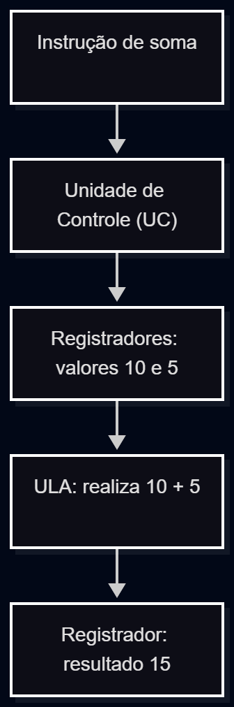
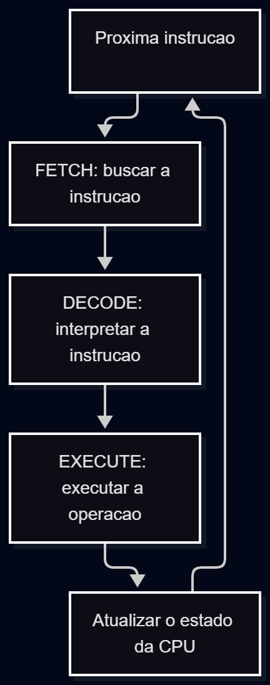
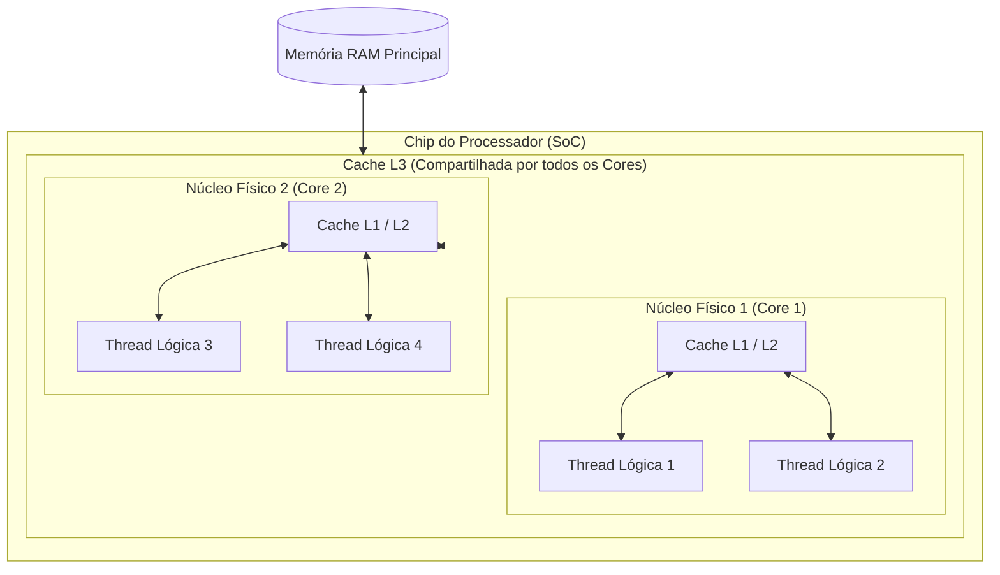

# Como os Processadores Funcionam?

## Introdução

Você já parou para pensar no que acontece dentro do computador quando executamos um programa?

Ao abrir um navegador, realizar um cálculo ou executar um código em Python, o computador precisa processar diversas instruções para produzir os resultados esperados.

Um dos principais responsáveis por esse trabalho é a **CPU (Central Processing Unit)**, também conhecida como Unidade Central de Processamento ou simplesmente processador.

A CPU é responsável por executar instruções, realizar operações matemáticas e lógicas e trabalhar em conjunto com outros componentes, como a memória RAM.

Para um desenvolvedor iniciante, compreender o funcionamento do processador é importante porque ajuda a entender como os programas são executados, como os recursos computacionais são utilizados e por que algumas tarefas demandam mais processamento do que outras.

Neste artigo, vamos conhecer os principais componentes internos da CPU, entender como acontece a execução das instruções e explorar características que influenciam seu desempenho.

---

## 1. Anatomia da CPU: conhecendo seus principais componentes

A CPU é formada por diferentes componentes que trabalham em conjunto para executar as instruções de um programa.

Para facilitar o entendimento, podemos imaginar o processador como uma equipe de trabalho: enquanto uma parte coordena as atividades, outra realiza operações e outra mantém informações disponíveis para uso imediato.

Entre seus componentes fundamentais, destacam-se a **Unidade Lógica e Aritmética (ULA)**, a **Unidade de Controle (UC)** e os **registradores**.

### 1.1 Unidade Lógica e Aritmética (ULA)

A Unidade Lógica e Aritmética, também conhecida como **ALU (Arithmetic Logic Unit)**, é responsável por executar operações matemáticas e lógicas dentro do processador.

Entre suas principais funções estão:

- **Operações aritméticas:** como adição e subtração.
- **Operações lógicas:** como AND, OR e NOT.
- **Comparações:** como verificar se dois valores são iguais ou se um número é maior que outro.

Imagine que estamos desenvolvendo um programa em Python:

```python
numero1 = 10
numero2 = 5

resultado = numero1 + numero2

print(resultado)  # Saída: 15
```

Quando esse programa é executado, o computador realiza uma série de operações para calcular o resultado.

Em uma explicação simplificada, instruções de máquina correspondentes à soma podem utilizar a ULA para realizar a operação aritmética.

A ULA também participa de operações relacionadas às decisões dos programas, como comparações utilizadas em estruturas condicionais.

**Analogia prática:**

Pense na ULA como uma calculadora especializada.

Ela recebe valores e uma operação a ser realizada, processa essas informações e produz um resultado.

A diferença é que, enquanto utilizamos números e símbolos matemáticos, a ULA trabalha com operações de baixo nível e informações representadas em bits.

> [!NOTE]
> A ULA trabalha com operações de baixo nível. Ela não interpreta diretamente um programa Python: antes, o código precisa passar pelos mecanismos de execução da linguagem.

### 1.2 Unidade de Controle (UC)

A **Unidade de Controle (UC)** é responsável por coordenar as atividades internas do processador.

Ela participa da interpretação das instruções e gera sinais de controle que orientam os demais componentes durante sua execução.

Entre suas principais responsabilidades estão:

- Participar da busca e da decodificação das instruções.
- Identificar quais operações precisam ser executadas.
- Coordenar o fluxo de dados entre os componentes internos.
- Controlar etapas da execução de instruções.

**Analogia prática:**

Podemos imaginar a Unidade de Controle como o **maestro de uma orquestra**.

O maestro não toca todos os instrumentos, mas coordena os músicos para que cada um entre no momento adequado.

Da mesma forma, a Unidade de Controle coordena as operações necessárias para que os componentes do processador trabalhem em conjunto.

Por exemplo, durante uma instrução de soma, a Unidade de Controle pode coordenar a leitura dos valores necessários, a operação realizada pela ULA e o armazenamento do resultado.

> [!IMPORTANT]
> A Unidade de Controle e a ULA possuem funções diferentes: a UC coordena a execução das instruções, enquanto a ULA realiza operações aritméticas e lógicas.

### 1.3 Registradores: armazenamento de alta velocidade

Os **registradores** são pequenas estruturas de armazenamento localizadas dentro do processador.

Eles armazenam temporariamente informações que precisam ser acessadas com muita rapidez durante a execução das instruções.

Essas informações podem incluir:

- Valores utilizados em operações.
- Resultados intermediários de cálculos.
- Endereços de memória.
- Informações relacionadas à instrução em execução.

Mas por que o processador precisa de registradores se o computador já possui memória RAM?

A resposta está na **velocidade de acesso**.

Os registradores ficam integrados ao processador e permitem acesso muito rápido a pequenas quantidades de informação, evitando que determinadas operações dependam de acessos frequentes à memória RAM.

**Analogia prática:**

Imagine um cozinheiro preparando uma receita.

A despensa representa um local com grande capacidade de armazenamento, enquanto a bancada representa o espaço próximo ao cozinheiro, onde ele deixa os ingredientes que utilizará imediatamente.

Os registradores funcionam de maneira semelhante à bancada: mantêm pequenas quantidades de informação prontas para serem utilizadas.

Em um cálculo como `10 + 5`, por exemplo, os valores podem estar em registradores antes de uma instrução de soma ser executada.

O resultado também pode ser armazenado em um registrador.

Um exemplo importante é o **Program Counter (PC)**, registrador associado ao endereço da próxima instrução no fluxo de execução, conforme a arquitetura do processador.

> [!TIP]
> Os registradores não substituem a RAM. Eles armazenam quantidades muito menores de informação e possuem funções específicas dentro da arquitetura do processador.

### 1.4 Comparando os componentes da CPU

| Componente | Função principal | Analogia |
|---|---|---|
| ULA | Realizar operações aritméticas e lógicas | Calculadora |
| Unidade de Controle | Coordenar a execução das instruções | Maestro |
| Registradores | Armazenar informações para acesso imediato | Bancada de trabalho |

### 1.5 Como esses componentes trabalham juntos?

Imagine que o processador precisa executar uma instrução que soma dois valores.

De maneira simplificada:

1. Os valores necessários ficam disponíveis em registradores ou são obtidos da hierarquia de memória.
2. A Unidade de Controle coordena a execução da instrução.
3. A ULA realiza a operação de soma.
4. O resultado é disponibilizado em um registrador e pode ser utilizado por instruções seguintes.

O diagrama abaixo representa esse processo de maneira simplificada:



Esse exemplo demonstra que os componentes não trabalham isoladamente. Eles cooperam para executar as operações necessárias ao funcionamento dos programas.

> [!NOTE]
> Esse diagrama é uma representação didática da cooperação entre os componentes, e não um esquema completo das conexões físicas de uma CPU.

Compreender essa organização é o primeiro passo para estudar o **ciclo de instrução Fetch–Decode–Execute**, responsável por descrever as etapas fundamentais da execução de instruções pela CPU.

---

## 2. O ciclo de instrução: Fetch → Decode → Execute

Agora que conhecemos os componentes fundamentais da CPU, podemos entender como eles trabalham juntos durante a execução de um programa.

Os processadores executam instruções por meio de uma sequência de etapas conhecida como **ciclo de instrução**.

Em sua representação mais simples, esse ciclo é dividido em três etapas:

1. **Fetch (Buscar):** obter a próxima instrução.
2. **Decode (Decodificar):** identificar qual operação deve ser realizada.
3. **Execute (Executar):** realizar a operação determinada.

Após uma instrução, o processador continua executando as próximas instruções conforme o fluxo do programa.

### 2.1 Fetch — Buscando a instrução

A primeira etapa é chamada de **Fetch**, ou busca.

Nessa fase, o processador obtém a próxima instrução que deverá ser executada.

As instruções de um programa ficam armazenadas na hierarquia de memória do computador. Durante a execução, elas podem ser recuperadas da memória cache ou da memória principal.

O processador utiliza mecanismos de controle, incluindo informações associadas ao contador de programa (*Program Counter*), para determinar quais instruções buscar.

**Analogia prática:**

Imagine um cozinheiro seguindo uma receita.

Antes de preparar um prato, ele precisa consultar qual é o próximo passo.

De maneira semelhante, a CPU precisa obter a próxima instrução antes de executá-la.

### 2.2 Decode — Decodificando a instrução

Depois de obter a instrução, o processador precisa identificar o que ela significa.

Essa etapa é chamada de **Decode**, ou decodificação.

As instruções de máquina são representadas por padrões de bits que seguem as regras da arquitetura do processador.

Durante a decodificação, o processador identifica informações como:

- Qual operação deve ser realizada.
- Quais registradores ou dados serão utilizados.
- Quais recursos internos precisam participar da execução.

Por exemplo, uma instrução pode indicar que o processador deve somar dois valores armazenados em registradores.

A Unidade de Controle participa dessa etapa, identificando a operação e gerando os sinais necessários à execução.

**Analogia prática:**

Voltando ao exemplo do cozinheiro, depois de ler a receita, ele precisa entender o que significa cada orientação.

Se a receita diz "misture dois ingredientes", ele interpreta essa instrução antes de realizar a tarefa.

O processador faz algo semelhante ao decodificar uma instrução de máquina.

### 2.3 Execute — Executando a instrução

Depois que a instrução foi identificada, chega o momento de executá-la.

Essa etapa é conhecida como **Execute**, ou execução.

Dependendo da instrução, o processador pode:

- Realizar uma operação matemática.
- Executar uma operação lógica.
- Ler ou escrever informações na memória.
- Alterar o fluxo de execução do programa.

Quando a instrução envolve um cálculo aritmético simples, a ULA pode realizar a operação.

O resultado pode ser escrito em um registrador ou, conforme a instrução, armazenado na memória.

Algumas descrições do ciclo incluem uma etapa adicional, chamada **Store** ou **Write-back**, para representar a gravação do resultado.

**Analogia prática:**

Depois de ler e compreender o próximo passo da receita, o cozinheiro finalmente executa a ação: mistura os ingredientes, aquece a panela ou prepara o alimento.

Da mesma forma, a CPU realiza a operação determinada pela instrução.

### 2.4 Exemplo prático: somando dois números

Para compreender o ciclo completo, imagine que precisamos somar dois números.

Em uma representação simplificada, podemos utilizar a seguinte instrução fictícia:

```text
ADD R3, R1, R2
```

Essa notação significa:

- `ADD`: operação de adição.
- `R1`: registrador contendo o primeiro valor.
- `R2`: registrador contendo o segundo valor.
- `R3`: registrador que receberá o resultado.

Suponha que:

```text
R1 = 10
R2 = 5
```

A execução pode ser compreendida assim:

**1. Fetch — Busca da instrução**

O processador busca a instrução:

```text
ADD R3, R1, R2
```

**2. Decode — Decodificação**

A instrução é interpretada como uma solicitação de soma utilizando os valores dos registradores `R1` e `R2`.

**3. Execute — Execução**

A ULA realiza a operação:

```text
10 + 5 = 15
```

O resultado é disponibilizado para ser armazenado em `R3`.

Ao final, temos:

```text
R3 = 15
```

> [!NOTE]
> O exemplo utiliza uma instrução fictícia, criada para fins didáticos. A sintaxe real das instruções varia conforme a arquitetura do processador. Além disso, uma expressão em uma linguagem de alto nível pode exigir várias instruções de máquina.

### 2.5 Diagrama visual do ciclo de instrução

O diagrama abaixo apresenta uma representação simplificada do ciclo Fetch–Decode–Execute.



Esse ciclo permite compreender a lógica fundamental da execução de instruções.

É importante observar que processadores modernos podem utilizar técnicas mais avançadas, como *pipeline*, execução fora de ordem e paralelismo interno, fazendo com que diferentes etapas de várias instruções se sobreponham.

Entretanto, o modelo Fetch–Decode–Execute continua sendo uma excelente introdução ao funcionamento da CPU.

### 2.6 Como os componentes da CPU participam do ciclo?

Podemos relacionar as etapas estudadas aos componentes apresentados anteriormente.

| Etapa | O que acontece | Componentes envolvidos |
|---|---|---|
| Fetch | Busca da próxima instrução | Unidade de Controle, registradores e hierarquia de memória |
| Decode | Identificação da operação | Unidade de Controle e circuitos de decodificação |
| Execute | Realização da operação | ULA ou outras unidades de execução, registradores e demais recursos necessários |

Dessa forma, conseguimos perceber que a ULA, a Unidade de Controle e os registradores trabalham em conjunto durante a execução das instruções.

---

## 3. Clock, Cores, Threads e Memória Cache

Quando você vai contratar um servidor na nuvem (como uma instância *AWS EC2) ou escolher um notebook de trabalho, pode notar algumas especificações como *"4 vCPUs, 3.5 GHz, 8MB Cache L3". Aqui você pode compreender os significados para otimizar custos e evitar dificuldades.

---

### 3.1. Clock (GHz)

O **Clock** é o sinal elétrico ritmado que dita a velocidade máxima com que a CPU executa instruções. Pense nele como o **metrônomo de um músico**.

* **O que significa GHz?** 1 Hertz (Hz) equivale a 1 ciclo por segundo. Logo, **3.0 GHz significa 3 bilhões de ciclos por segundo**.
* **O Mito da Frequência:** Nem sempre um processador com maior GHz é mais rápido que outro com menor GHz. A velocidade real depende do número de **IPC (Instruções Por Ciclo)** que a arquitetura do chip consegue processar no mesmo pulso de clock.

> [!]
> **Por que o Clock parou de subir sem parar, mesmo com inovações?**
> Antigamente, a corrida das fabricantes era apenas aumentar os GHz. No entanto, surgiu a preocupação com a **Barreira Térmica (Thermal Wall)**: aumentar mais o clock gera um calor absurdo e consome energia desproporcional, arriscando derreter o silício.

---

### 3.2. Cores (Núcleos Físicos)

Para continuar aumentando o desempenho dos computadores sem explodir o consumo de energia, a indústria mudou a estratégia: em vez de fazer um único núcleo rodar cada vez mais rápido, colocaram **vários núcleos físicos independentes dentro do mesmo chip** (arquitetura *Multi-core*).

* **Single-core vs. Multi-core:** Um processador *Quad-Core* possui **4 mini-processadores físicos** completos no mesmo chip, permitindo executar 4 tarefas simultaneamente de forma real.

> [!DICA]
> **Aplicação para Devs:**
> Aplicações escritas para rodar em uma única *thread* (como o modelo padrão do Node.js ou scripts em Python puro) utilizam apenas **1 único Core** por padrão, deixando os demais livres para o Sistema Operacional ou outros processos.

---

### 3.3. Threads

Enquanto o **Core** é a unidade física de processamento, a **Thread** (no contexto de hardware) representa um **fluxo lógico de execução**. 

Para evitar que um núcleo físico fique ocioso enquanto espera dados chegarem da memória RAM, tecnologias como **Hyper-Threading (Intel)** e **SMT (AMD)** permitem que **1 núcleo físico gerencie 2 fluxos lógicos simultaneamente**.

* 🍳 **Analogy do Cozinheiro:**
  * **Core (Núcleo Físico):** Um cozinheiro.
  * **1 Thread por Core:** O cozinheiro usa apenas a mão direita para cortar vegetais.
  * **2 Threads por Core (Hyper-Threading):** O cozinheiro usa a mão esquerda para adiantar o corte da carne enquanto a mão direita cuida da panela. Ele continua sendo **um único cozinheiro (1 Core)**, mas aproveita seu tempo ocioso para adiantar **duas tarefas (2 Threads)**.

> [!IMPORTANTE]
> **Na Nuvem AWS:**
> Em instâncias AWS EC2, **1 vCPU (Virtual CPU)** equivale geralmente a **1 Thread lógica** (hyper-thread) do processador físico, e não a um núcleo inteiro dedicado.

---

### 3.4. Memória Cache (L1, L2, L3): A Ponte Entre a CPU e a RAM

A memória RAM é rápida, mas para a velocidade atômica da CPU, ela ainda é extremamente lenta (a busca na RAM pode levar centenas de ciclos de clock ociosos, gerando o chamado *Cache Miss*). 

Para resolver isso, os processadores possuem a **Memória Cache**: pequenas áreas de memória ultrarrápida (SRAM) construídas dentro do próprio chip da CPU.

* 🎒 **Analogia do Bolso do Cozinheiro:**
  * **Registradores:** Os ingredientes que já estão nas mãos do cozinheiro.
  * **Cache L1:** Os temperos no bolso (acesso instantâneo, espaço mínimo).
  * **Cache L2:** Os ingredientes organizados na bancada de trabalho.
  * **Cache L3:** A prateleira compartilhada da cozinha (maior espaço, um pouco mais distante).
  * **RAM:** O estoque nos fundos do restaurante (muito espaço, mas exige caminhar até lá).

#### Níveis da Memória Cache:

1. **L1 (Level 1):** Minúscula (~32KB a 128KB por núcleo), fica integrada ao núcleo e roda na velocidade exata da CPU.
2. **L2 (Level 2):** Intermediária (~512KB a 2MB por núcleo), rápida e dedicada a cada núcleo.
3. **L3 (Level 3):** Maior (~8MB a 64MB+), **compartilhada** por todos os núcleos físicos do chip.

---

### 3.5. Tabela Comparativa: Hierarquia de Memória

| Camada | Localização | Velocidade Relativa | Capacidade Típica | Finalidade Principal |
| :--- | :--- | :--- | :--- | :--- |
| **Registradores** | Dentro do Core (ULA/UC) | Imensurável (< 1 ns) | Bytes (~1 KB total) | Operações matemáticas e lógicas iminentes. |
| **Cache L1** | Dentro de cada Core | Extrema (~1-2 ns) | 32 KB - 128 KB | Armazenar instruções e dados do próximo passo imediato. |
| **Cache L2** | Junto ao Core | Muito Alta (~3-5 ns) | 512 KB - 2 MB | Reter dados locais frequentemente reusados. |
| **Cache L3** | No Chip (Compartilhada) | Alta (~10-20 ns) | 8 MB - 64 MB+ | Troca eficiente de dados entre múltiplos núcleos. |
| **Memória RAM** | Placa-Mãe (Externa) | Moderada (~50-100 ns) | 8 GB - 128 GB+ | Guardar programas em execução e dados do SO. |

---

### 3.6. Arquitetura em Ação (Fluxo de Execução)

O diagrama abaixo ilustra como os Cores, Threads e níveis de Cache se organizam internamente no chip da CPU:



---

## Principais pontos de atenção

- A **CPU** é responsável por executar instruções dos programas.
- A **ULA** realiza operações matemáticas e lógicas.
- A **Unidade de Controle** participa da interpretação das instruções e coordena sua execução.
- Os **registradores** armazenam pequenas quantidades de dados com acesso extremamente rápido.
- O ciclo **Fetch–Decode–Execute** descreve as etapas fundamentais de busca, decodificação e execução de instruções.
- A execução de programas reais envolve diversos componentes e pode utilizar técnicas mais avançadas do que o modelo simplificado apresentado.
- O **Clock (GHz)** indica a frequência máxima de pulsos por segundo do processador, mas parou de crescer isoladamente devido à *Barreira Térmica*.
- **Cores (Núcleos Físicos)** são processadores independentes no mesmo chip; **Threads** são fluxos lógicos de execução que otimizam o tempo ocioso do núcleo física (tecnologia Hyper-Threading / SMT).
- A **Memória Cache (L1, L2, L3)** é uma camada ultrarrápida situada entre a CPU e a RAM, essencial para prevenir ociosisdade (*Cache Miss*).

---

## Referências e materiais recomendados

1. **Harvard — CS50's Understanding Technology: Week 1 — Hardware.**  
   https://cs50.harvard.edu/technology/weeks/1/

2. **Harvard — CS50's Understanding Technology: Hardware Notes.**  
   https://cs50.harvard.edu/technology/notes/1/

3. **Harvard — CS50 AP: CPU and SoC.**  
   https://cs50.harvard.edu/ap/2023/curriculum/technology/references/cpu_and_soc.pdf

4. **Harvard — CS50 AP: Hardware.**  
   https://cs50.harvard.edu/ap/2025/curriculum/technology/weeks/hardware/

---

### ⬅️ Navegação entre Artigos
- ⬅️ **Anterior:** [01 - Como funciona um computador](../arquitetura-e-hardware/01-como-funciona-um-computador.md)
- ➡️ **Próximo:** [03 - Como os programas passam na memória](../arquitetura-e-hardware/03-como-os-programas-rodam-na-memoria.md)
