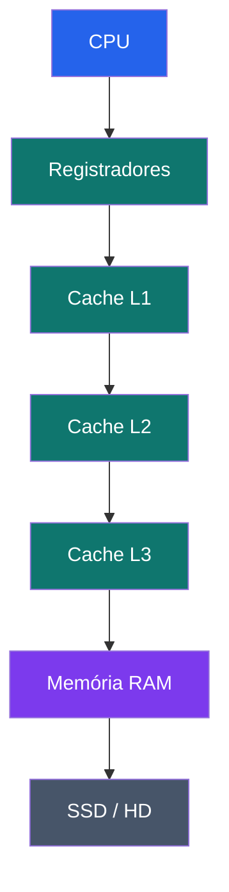
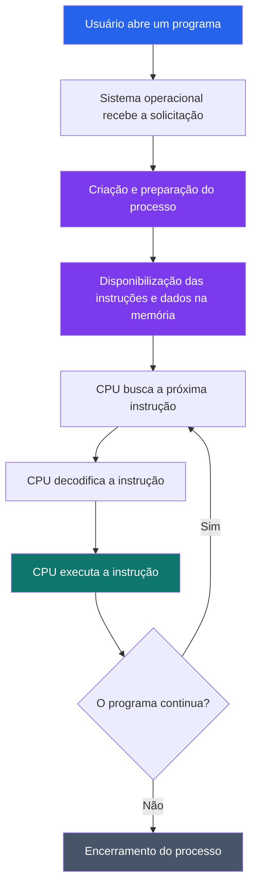
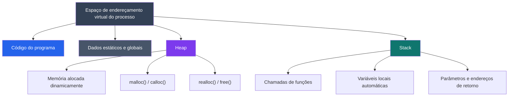

# Como os Programas Rodam na Memória?

## 1. Introdução

Você já parou para pensar no que acontece quando clicamos duas vezes no ícone de um programa e ele começa a funcionar?

Por trás dessa ação aparentemente simples, existe uma série de operações envolvendo o processador (CPU), a memória RAM e os dispositivos de armazenamento.

Um programa não funciona simplesmente porque está salvo no computador. Para ser executado, suas instruções e seus dados precisam ser disponibilizados ao processador, que realiza operações utilizando diferentes níveis de memória.

Compreender esse funcionamento é fundamental para qualquer desenvolvedor, pois permite entender como os programas são executados, como os dados são armazenados e como o computador gerencia seus recursos.

Neste artigo, vamos explorar a hierarquia de memória dos computadores, as diferenças entre RAM, SSD e HD, o processo de execução de um programa e os conceitos de Stack e Heap.

---

## 2. Entendendo a hierarquia de memória

Um computador possui diferentes tipos de memória, cada um com características e finalidades específicas.

Se todos os dados fossem armazenados em um único lugar, o computador teria dificuldades para equilibrar velocidade, capacidade de armazenamento e custo.

Por esse motivo, os computadores utilizam uma estrutura chamada **hierarquia de memória**, que organiza os diferentes níveis de armazenamento de acordo com sua velocidade, capacidade e proximidade do processador.

### 2.1. Os níveis da hierarquia

De maneira geral, podemos organizar os principais níveis de memória da seguinte forma:

| Nível | Tipo | Característica principal |
|---|---|---|
| 1 | Registradores | Extremamente rápidos e localizados dentro da CPU. |
| 2 | Cache | Mantém dados e instruções frequentemente utilizados pela CPU. |
| 3 | Memória RAM | Armazena temporariamente programas e dados em uso. |
| 4 | SSD | Armazenamento persistente baseado em memória flash. |
| 5 | HD (HDD) | Armazenamento persistente baseado em discos magnéticos. |

**Regra geral:** quanto mais próximo do processador, menor tende a ser a capacidade de armazenamento e maior tende a ser a velocidade de acesso.

Por outro lado, os dispositivos de armazenamento, como SSDs e HDs, oferecem capacidades maiores, mas apresentam velocidades inferiores às das memórias utilizadas diretamente pelo processador.

### 2.2. Visualizando a hierarquia de memória

O diagrama abaixo representa uma organização simplificada dos níveis de memória:



*Observação: o diagrama apresenta uma representação didática. A organização física e o funcionamento dos níveis de cache podem variar conforme a arquitetura do processador.*

### 2.3. Registradores

Os registradores são pequenas unidades de armazenamento localizadas dentro do processador.

Eles guardam temporariamente valores, endereços e informações necessários para a execução das instruções.

Por estarem diretamente integrados à CPU, permitem acessos extremamente rápidos.

**Exemplo:** imagine que o processador precise somar dois números. Os valores podem ser carregados em registradores, onde a operação será realizada.

### 2.4. Memória Cache

A memória cache é utilizada para reduzir o tempo necessário para que o processador encontre dados e instruções que utiliza frequentemente.

Imagine um estudante que está resolvendo uma atividade:

- Os livros guardados em outra sala representam o armazenamento de longo prazo.
- Os livros colocados sobre a mesa representam os materiais disponíveis rapidamente.
- O material que está nas mãos do estudante representa aquilo que está sendo utilizado naquele instante.

A cache funciona de maneira semelhante: mantém cópias de informações que podem ser necessárias novamente, evitando acessos mais demorados à memória RAM.

Existem diferentes níveis de cache:

- **L1:** geralmente a menor e mais rápida.
- **L2:** possui capacidade maior que a L1 e tende a ser um pouco mais lenta.
- **L3:** geralmente possui capacidade maior e pode ser compartilhada entre diferentes núcleos do processador.

Nem todo processador possui exatamente a mesma organização.

---

## 3. HD, SSD e memória RAM: qual é a diferença?

É muito comum confundir memória RAM com armazenamento. Embora ambos guardem informações, suas funções são diferentes.

Para entender melhor, precisamos distinguir dois conceitos:

- **Memória volátil:** perde seu conteúdo quando deixa de receber energia.
- **Memória não volátil:** mantém os dados mesmo quando o computador é desligado.

A memória RAM é volátil, enquanto SSDs e HDs são dispositivos de armazenamento não volátil.

### 3.1. Memória RAM

RAM significa *Random Access Memory* (Memória de Acesso Aleatório).

É a memória utilizada pelo computador para manter temporariamente programas e dados que estão sendo utilizados.

Quando você abre um navegador, um editor de texto ou um jogo, o sistema operacional disponibiliza na memória RAM os dados necessários para sua execução.

Suas principais características são:

- Alta velocidade de acesso em comparação com SSDs e HDs.
- Permite leitura e escrita de dados.
- É volátil.
- Possui capacidade limitada.
- É utilizada durante a execução de programas.

**Analogia:** imagine uma mesa de estudos. Você coloca sobre ela os livros e materiais que está utilizando naquele momento. Quanto maior a mesa, mais materiais consegue manter disponíveis sem precisar buscá-los novamente.

A RAM funciona de maneira semelhante: mantém informações disponíveis para que o processador possa utilizá-las.

### 3.2. HD (HDD)

O HD, também conhecido como HDD (*Hard Disk Drive*), é um dispositivo de armazenamento que utiliza discos magnéticos para registrar informações.

Diferentemente da RAM, os dados armazenados em um HD permanecem disponíveis mesmo quando o computador é desligado.

Suas características incluem:

- Grande capacidade de armazenamento.
- Armazenamento não volátil.
- Utilização de componentes mecânicos.
- Velocidade inferior à da memória RAM e, geralmente, à dos SSDs.

**Analogia:** o HD funciona como um arquivo físico onde você guarda documentos e materiais que não precisa utilizar o tempo inteiro.

### 3.3. SSD (Solid State Drive)

O SSD é um dispositivo de armazenamento que utiliza memória flash para guardar informações.

Assim como o HD, permite armazenar arquivos, programas e sistemas operacionais mesmo quando o computador está desligado.

Entretanto, utiliza componentes eletrônicos, sem discos magnéticos giratórios ou cabeças mecânicas de leitura.

Suas principais características são:

- Alta velocidade de leitura e escrita em comparação com HDs convencionais.
- Armazenamento não volátil.
- Ausência de partes móveis.
- Menor tempo de carregamento de arquivos e programas em comparação com HDs tradicionais.

**Analogia:** imagine substituir um arquivo físico por um sistema digital de consulta. Você continua guardando os mesmos documentos, mas consegue encontrá-los com muito mais rapidez.

### 3.4. Comparação entre RAM, SSD e HD

| Característica | RAM | SSD | HD |
|---|---|---|---|
| Função | Memória de trabalho | Armazenamento | Armazenamento |
| Volatilidade | Volátil | Não volátil | Não volátil |
| Tecnologia | Circuitos de memória | Memória flash | Discos magnéticos |
| Velocidade | Muito alta | Alta | Geralmente menor |
| Capacidade | Geralmente menor | Geralmente maior | Geralmente maior |
| Dados após desligar | Perdidos | Preservados | Preservados |

> [!IMPORTANT]
> RAM, SSD e HD não são substitutos uns dos outros. Cada um desempenha uma função diferente no funcionamento do computador.

---

## 4. O que acontece quando abrimos um programa?

Agora que entendemos os diferentes tipos de memória, podemos acompanhar o caminho percorrido por um programa durante sua execução.

Imagine que você esteja utilizando um computador e clique duas vezes no ícone de um navegador.

O que acontece nos bastidores?

### 4.1. O programa está armazenado no SSD ou HD

Antes de ser executado, o programa está armazenado em um dispositivo de armazenamento, como um SSD ou HD.

Nesse dispositivo ficam os arquivos necessários para sua instalação e execução, incluindo instruções, bibliotecas e outros recursos.

Entretanto, o processador não utiliza simplesmente o arquivo armazenado no SSD como se ele fosse sua memória de trabalho.

### 4.2. O sistema operacional inicia o processo

Quando solicitamos a abertura de um programa, o sistema operacional coordena sua inicialização.

Ele cria um processo, prepara seu espaço de endereçamento virtual e organiza os recursos necessários para sua execução.

Um processo pode ser entendido como uma instância de um programa em execução.

Por exemplo, o navegador instalado no computador é um programa. Quando ele é aberto, uma ou mais instâncias de execução são criadas e gerenciadas pelo sistema operacional.

### 4.3. Os dados são disponibilizados na memória

O sistema operacional e os mecanismos de memória virtual disponibilizam as partes necessárias do programa para execução.

Isso não significa necessariamente que todo o arquivo seja carregado de uma única vez na RAM.

Em sistemas modernos, o carregamento pode acontecer gradualmente, conforme as páginas de memória são necessárias.

Essa estratégia permite utilizar melhor os recursos disponíveis.

### 4.4. O processador executa as instruções

Com as instruções e os dados necessários disponíveis, o processador começa a executar o programa.

De maneira simplificada, podemos representar esse funcionamento por três etapas:

1. **Busca (Fetch):** o processador busca a próxima instrução.
2. **Decodificação (Decode):** interpreta o que a instrução determina.
3. **Execução (Execute):** realiza a operação solicitada.

Esse ciclo é conhecido como *Fetch-Decode-Execute*.

Ele acontece continuamente durante a execução dos programas.

### 4.5. Visualizando o processo



**Em resumo:** o programa fica armazenado no SSD ou HD, o sistema operacional prepara sua execução, os dados e instruções necessários são disponibilizados na memória e a CPU executa as operações.

---

## 5. Memória virtual: como o sistema operacional organiza a memória?

Até aqui, falamos sobre a memória RAM como espaço utilizado pelos programas. Porém, existe outro conceito importante: a memória virtual.

A memória virtual é um mecanismo que permite que cada processo tenha seu próprio espaço de endereçamento virtual.

Isso significa que um programa trabalha com endereços virtuais, que são traduzidos para endereços físicos pela arquitetura de memória do computador.

O sistema operacional, juntamente com o hardware de gerenciamento de memória, controla esse processo.

### 5.1. Por que a memória virtual é importante?

Imagine que você esteja utilizando vários programas simultaneamente:

- Um navegador.
- Um editor de código.
- Um terminal.
- Um aplicativo de música.

Cada processo possui seu próprio espaço de endereçamento virtual.

Essa separação oferece benefícios importantes:

- **Isolamento:** um processo não deve acessar livremente a memória privada de outro.
- **Organização:** cada processo possui uma visão própria da memória.
- **Proteção:** mecanismos de permissão ajudam a impedir acessos indevidos.
- **Flexibilidade:** o sistema pode administrar a memória física de maneira mais eficiente.

### 5.2. Memória virtual e memória física são a mesma coisa?

Não.

| Memória virtual | Memória física |
|---|---|
| Espaço de endereços utilizado pelo processo. | Memória RAM instalada no computador. |
| Gerenciada com auxílio do sistema operacional e do hardware. | Composta pelos módulos físicos de RAM. |
| Permite isolamento entre processos. | Armazena fisicamente páginas de memória em uso. |

A memória virtual não significa que o computador possui uma quantidade ilimitada de RAM.

Quando a memória física fica pressionada, o sistema operacional pode utilizar mecanismos como paginação e armazenamento secundário para administrar os dados.

No Windows, por exemplo, existe o arquivo de paginação (*pagefile*).

> [!NOTE]
> A utilização de memória virtual não transforma um SSD ou HD em uma RAM equivalente. O acesso ao armazenamento secundário é significativamente mais lento do que o acesso à memória RAM.

---

## 6. Stack e Heap: como os dados são organizados durante a execução?

Agora chegamos a dois conceitos fundamentais para quem está aprendendo programação: Stack e Heap.

Quando um programa é executado, ele precisa armazenar diferentes tipos de informações, como variáveis, parâmetros de funções e dados criados durante a execução.

Para organizar essas informações, existem diferentes regiões de memória.

Entre elas, duas bastante importantes são:

- **Stack (Pilha):** utilizada para organizar chamadas de funções e seus dados associados.
- **Heap (Área de alocação dinâmica):** utilizada para reservar memória dinamicamente durante a execução.

Essas regiões possuem características e formas de gerenciamento diferentes.

### 6.1. Stack (Pilha)

A Stack é uma região de memória utilizada para organizar informações relacionadas às chamadas de funções.

Ela segue, conceitualmente, a estrutura LIFO (*Last In, First Out*), ou seja, o último elemento inserido é o primeiro a ser removido.

Isso significa que as chamadas de funções são organizadas de maneira que a função mais recentemente chamada seja a primeira a retornar.

Quando uma função é chamada, é criado um contexto de execução, frequentemente representado por um *stack frame* (quadro de pilha).

Esse quadro pode armazenar informações como:

- Variáveis locais.
- Parâmetros da função.
- Endereço de retorno.
- Informações necessárias para continuar a execução.

Quando a função termina, seu quadro de pilha deixa de ser utilizado.

### 6.2. Analogia da Stack

Imagine uma pilha de pratos:

1. Você coloca um prato sobre o outro.
2. O último prato colocado fica no topo.
3. Quando precisa retirar um prato, começa pelo que está no topo.

O funcionamento da Stack segue uma lógica semelhante.

As chamadas de funções são organizadas em uma pilha, e a chamada mais recente precisa terminar antes que a execução retorne à função anterior.

### 6.3. Exemplo prático em C

Observe o código:

```c
#include <stdio.h>

void segundaFuncao() {
    int numero = 20;
    printf("%d\n", numero);
}

void primeiraFuncao() {
    int numero = 10;

    segundaFuncao();

    printf("%d\n", numero);
}

int main() {
    primeiraFuncao();

    return 0;
}
```

**Saída:**

```text
20
10
```

O que acontece?

1. A função `main()` chama `primeiraFuncao()`.
2. `primeiraFuncao()` cria sua variável local `numero`.
3. `primeiraFuncao()` chama `segundaFuncao()`.
4. `segundaFuncao()` cria sua própria variável `numero`.
5. A segunda função imprime `20` e termina.
6. A execução retorna para `primeiraFuncao()`, que imprime `10`.
7. A execução termina.

Observe que as duas funções possuem variáveis chamadas `numero`, mas elas pertencem a contextos diferentes.

Esse exemplo ajuda a entender como as chamadas de funções são organizadas durante a execução.

### 6.4. Heap (Alocação dinâmica)

A Heap é uma região de memória utilizada para alocação dinâmica.

Diferentemente de uma variável local comum, cuja duração geralmente está associada à execução de um bloco ou função, a memória alocada dinamicamente pode continuar disponível mesmo depois que a função que solicitou a alocação termina.

Em C, podemos utilizar funções da biblioteca `stdlib.h` para gerenciar esse tipo de memória:

- `malloc()`: solicita um bloco de memória.
- `calloc()`: solicita memória e inicializa seus bytes com zero.
- `realloc()`: altera o tamanho de um bloco previamente alocado.
- `free()`: libera a memória alocada dinamicamente.

### 6.5. Analogia da Heap

Imagine que você esteja organizando um evento.

Você não sabe exatamente quantas cadeiras serão necessárias, pois o número de participantes pode mudar.

Em vez de reservar uma quantidade fixa de cadeiras antecipadamente, você solicita novas cadeiras conforme a necessidade e as devolve quando não são mais utilizadas.

A Heap funciona de maneira semelhante: permite solicitar e liberar memória durante a execução do programa, conforme a necessidade.

### 6.6. Exemplo prático em C

```c
#include <stdio.h>
#include <stdlib.h>

int main() {
    int *numero;

    numero = malloc(sizeof(int));

    if (numero == NULL) {
        printf("Erro ao alocar memoria!\n");
        return 1;
    }

    *numero = 50;

    printf("Valor: %d\n", *numero);

    free(numero);

    numero = NULL;

    return 0;
}
```

**Saída:**

```text
Valor: 50
```

Vamos entender o que aconteceu:

1. Criamos um ponteiro chamado `numero`.
2. Utilizamos `malloc()` para solicitar espaço suficiente para armazenar um inteiro.
3. Verificamos se a alocação foi bem-sucedida.
4. Armazenamos o valor `50` no espaço reservado.
5. Imprimimos o valor armazenado.
6. Utilizamos `free()` para liberar a memória.
7. Atribuímos `NULL` ao ponteiro para evitar que ele continue guardando o endereço que acabou de ser liberado.

> [!WARNING]
> Esquecer de liberar uma memória que não será mais utilizada pode provocar um problema chamado *memory leak* (vazamento de memória). Isso acontece quando o programa continua reservando memória sem necessidade, podendo comprometer o desempenho e os recursos disponíveis.

### 6.7. Comparação entre Stack e Heap

| Característica | Stack | Heap |
|---|---|---|
| Finalidade | Organizar chamadas de funções e seus dados. | Armazenar dados alocados dinamicamente. |
| Gerenciamento | Geralmente automático pelo mecanismo de execução. | Depende do gerenciamento de memória da linguagem ou do ambiente. |
| Organização | Estrutura de pilha (LIFO) para chamadas. | Alocação e liberação de blocos de memória. |
| Duração dos dados | Geralmente associada à duração do contexto de execução. | Pode ultrapassar a execução da função que solicitou a alocação. |
| Exemplo em C | Variáveis locais automáticas. | Memória solicitada com `malloc()`. |

### 6.8. Visualizando Stack e Heap

O diagrama representa uma organização conceitual simplificada do espaço de memória de um processo:



*Observação: a disposição das regiões é ilustrativa. O layout real depende do sistema operacional, da arquitetura e do ambiente de execução.*

---

## 7. O que acontece quando o programa é encerrado?

Quando um programa termina, o sistema operacional realiza o encerramento do processo e recupera os recursos associados a ele.

Entre esses recursos estão as regiões de memória utilizadas pelo processo.

No caso da memória dinâmica em C, entretanto, é importante liberar corretamente os blocos que não serão mais utilizados enquanto o programa continua em execução.

Isso porque, embora o sistema operacional normalmente recupere a memória do processo ao encerrá-lo, deixar alocações sem liberação durante sua execução pode provocar vazamentos de memória.

Por isso, gerenciar corretamente a memória é uma responsabilidade importante na programação, especialmente em linguagens como C e C++.

---

## 8. Principais pontos de atenção (Key Takeaways)

Depois de estudar os conceitos apresentados, é importante guardar algumas ideias fundamentais:

1. **A memória é hierárquica:** computadores utilizam diferentes níveis de memória para equilibrar velocidade, capacidade e custo.
2. **RAM não é armazenamento permanente:** seu conteúdo é volátil e utilizado durante a execução dos programas.
3. **SSD e HD armazenam dados permanentemente:** ambos preservam arquivos mesmo quando o computador é desligado.
4. **O sistema operacional gerencia a execução:** ele cria processos e organiza os recursos necessários para os programas funcionarem.
5. **A CPU executa instruções:** o processador busca, decodifica e executa instruções continuamente.
6. **Memória virtual oferece isolamento:** cada processo possui seu próprio espaço de endereçamento virtual.
7. **Stack organiza chamadas de funções:** mantém informações relacionadas aos contextos de execução.
8. **Heap permite alocação dinâmica:** possibilita solicitar memória durante a execução do programa.
9. **Gerenciar memória é importante:** alocações desnecessárias e ausência de liberação podem causar vazamentos de memória.

> [!TIP]
> Para compreender melhor esses conceitos, pratique programação em C utilizando variáveis locais, ponteiros, funções e alocação dinâmica com `malloc()` e `free()`. A prática ajuda a visualizar como a memória é utilizada durante a execução.

---

## 9. Referências

As fontes abaixo foram utilizadas como base para a construção deste material e podem ser consultadas para aprofundar os estudos.

### Harvard CS50 — Understanding Technology

- [Week 1: Hardware](https://cs50.harvard.edu/technology/weeks/1/) — Material introdutório sobre hardware, processadores, memória RAM, HD, SSD e hierarquia de memória.
- [Hardware — Lecture Notes](https://cs50.harvard.edu/technology/notes/1/) — Anotações de apoio sobre os componentes físicos do computador e seu funcionamento.

### Microsoft Learn

- [About Memory Management](https://learn.microsoft.com/en-us/windows/win32/memory/about-memory-management) — Introdução ao gerenciamento de memória e ao espaço de endereçamento dos processos.
- [Virtual Address Space and Physical Storage](https://learn.microsoft.com/en-us/windows/win32/memory/virtual-address-space-and-physical-storage) — Explicação sobre memória virtual, memória física e paginação.

### Linux Kernel Documentation

- [The /proc Filesystem](https://www.kernel.org/doc/html/latest/filesystems/proc.html) — Documentação sobre informações dos processos e suas regiões de memória, incluindo Stack e Heap.

### Linux Man-pages

- [proc_pid_maps(5)](https://manpages.ubuntu.com/manpages/noble/man5/proc_pid_maps.5.html) — Documentação sobre as regiões de memória mapeadas de um processo Linux.

### Material complementar

- [CS50 — How Computers Work](https://cs50.harvard.edu/ap/2026/curriculum/technology/references/how_computers_work.pdf) — Material complementar sobre os componentes e o funcionamento dos computadores.

---

*Material desenvolvido para o módulo 01 — Fundamentos, da trilha Do Zero ao Júnior, do AWS Student Builder Group (SENAI CIMATEC).* 
