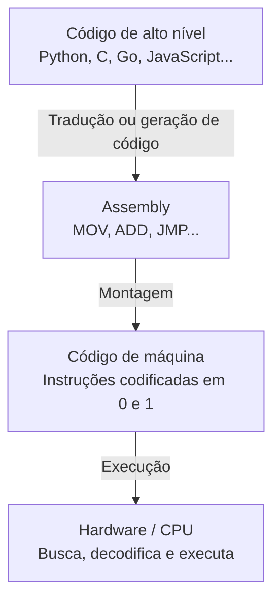

# Do Código-Fonte ao Código de Máquina: Como a CPU Entende um Programa?

> **Módulo 01 — Fundamentos | Sub-issue 06: Diferença de Linguagem Compilada e Interpretada**  
> **Arquivo 01:** Código-fonte e código de máquina  
> **Público-alvo:** pessoas que estão começando na programação.

## Introdução: como uma linha de código vira uma ação?

Imagine que você está desenvolvendo um sistema de uma loja virtual. Ao finalizar uma compra, o programa precisa calcular o valor total:

```python
total = preco * quantidade
```

Para quem programa, a intenção é clara: multiplicar o preço de um produto pela quantidade comprada e guardar o resultado. Mas surge uma pergunta:

**Como um processador, que não entende palavras como `total`, `preco` e `quantidade`, consegue realizar essa operação?**

Essa é a ponte que vamos construir neste artigo. Você vai conhecer os diferentes níveis de representação de um programa, entender o que realmente existe dentro de um arquivo de código-fonte e descobrir por que precisamos de ferramentas de tradução para executar nossas ideias.

**Ao final da leitura, você será capaz de:**

- Explicar por que código-fonte não é executado diretamente pela CPU.
- Diferenciar linguagem de alto nível, Assembly e código de máquina.
- Identificar o papel básico de registradores, ULA e instruções de desvio.
- Reconhecer um arquivo `.py`, `.js`, `.java` ou `.c` como texto que contém código-fonte.
- Entender, em linhas gerais, onde entram compiladores, interpretadores e ambientes de execução.

---

## 1. O abismo entre humanos e máquinas

### 1.1 Duas formas diferentes de entender uma tarefa

Nós descrevemos problemas usando **objetivos, regras e conceitos**:

> "Se o usuário estiver ativo, envie um e-mail de confirmação."

Em uma linguagem de alto nível, a ideia pode ser escrita de forma próxima à linguagem humana:

```python
if usuario_ativo:
    enviar_email()
```

A CPU, por outro lado, **não compreende diretamente** a palavra `if`, o nome de uma função ou a regra de negócio. Ela executa instruções de máquina definidas para sua arquitetura: carregar dados, operar sobre valores, comparar resultados, desviar para outra instrução etc.

**Analogia — uma cozinha profissional:** o cliente pede "quero um bolo"; a cozinha precisa transformar esse pedido em operações concretas, como separar ingredientes, medir quantidades, misturar e assar. Da mesma forma, uma regra de negócio precisa ser transformada em operações que o hardware consiga executar.

### 1.2 O que a CPU realmente faz?

O processador opera com dados e instruções representados por **bits** (`0` e `1`). Esses bits correspondem, fisicamente, a estados de circuitos eletrônicos. O significado de cada sequência depende do contexto e, no caso das instruções, da **arquitetura do processador**.

Alguns elementos fundamentais são:

| Elemento | Função principal | Analogia |
| --- | --- | --- |
| **Registradores** | Guardam temporariamente valores usados diretamente pela CPU. | Pequenos espaços sobre a mesa de trabalho. |
| **ULA (Unidade Lógica e Aritmética)** | Realiza operações aritméticas e lógicas, como soma e comparações. | A calculadora da equipe. |
| **Memória RAM** | Mantém dados e instruções dos programas durante sua execução. | A bancada onde os materiais ficam disponíveis. |
| **Unidade de controle** | Coordena a busca, a decodificação e a execução de instruções. | Quem organiza a sequência de tarefas. |

Em uma visão simplificada, o ciclo de uma instrução é:

1. **Buscar:** obter da memória a próxima instrução.
2. **Decodificar:** identificar qual operação aquela sequência de bits representa.
3. **Executar:** realizar a operação, possivelmente atualizando registradores ou a memória.
4. **Prosseguir:** seguir para a próxima instrução ou desviar para outro endereço.

Esse é um modelo didático. CPUs modernas podem executar diversas operações em paralelo e usar técnicas mais complexas internamente.

### 1.3 As instruções elementares por trás de um programa

Mesmo um programa elaborado depende de operações relativamente simples. Por exemplo:

- **Movimentar dados:** carregar um valor da memória para um registrador.
- **Calcular:** somar ou multiplicar valores usando unidades de execução da CPU.
- **Comparar:** verificar condições que influenciam o fluxo do programa.
- **Desviar:** continuar em outro ponto do código, implementando decisões e repetições.

Quando escrevemos um `if` ou um `while`, não estamos dando à CPU uma palavra mágica: estamos descrevendo uma lógica que o ambiente de execução precisará implementar com instruções de máquina.

> **Conexão com a CS50:** a aula *Week 1: Hardware*, de Harvard, apresenta o sistema binário, transistores, CPU, registradores e memória. Esses conceitos ajudam a compreender por que todas as instruções executadas pelo processador precisam, em última instância, estar representadas em bits.

---

## 2. Os três níveis de abstração do código

**Abstração** é a capacidade de esconder detalhes complexos e trabalhar com uma representação mais simples. Quanto mais alto o nível de abstração, menos precisamos pensar nos detalhes específicos do hardware ao escrever o programa.

### 2.1 Código de máquina: o nível que a CPU executa

O **código de máquina** é formado por instruções codificadas em bits. Cada família de processadores define quais instruções reconhece e como elas são representadas.

Por exemplo, computadores com arquitetura **x86-64** e dispositivos com arquitetura **ARM** não usam necessariamente as mesmas instruções ou os mesmos formatos binários. Um executável produzido para uma arquitetura não funciona automaticamente em outra.

Veja uma sequência ilustrativa de bytes de uma instrução real da arquitetura x86-64:

```text
Hexadecimal: B8 05 00 00 00
Binário:     10111000 00000101 00000000 00000000 00000000
```

Nesse contexto, essa sequência corresponde à instrução de colocar o valor `5` no registrador `EAX`. O hexadecimal é apenas uma forma mais compacta de escrever os mesmos bits; não é uma linguagem diferente executada pela CPU.

**Por que não programamos diretamente em binário?** Porque seria extremamente trabalhoso ler, escrever, revisar e manter milhares ou milhões de bits manualmente. Um pequeno erro poderia alterar inteiramente o significado de uma instrução.

### 2.2 Assembly: instruções de máquina com nomes legíveis

O **Assembly** (linguagem de montagem) utiliza nomes curtos, chamados *mnemônicos*, para representar instruções da arquitetura do processador.

Alguns exemplos comuns no Assembly x86 são:

| Mnemônico | Ideia geral |
| --- | --- |
| `MOV` | Mover ou copiar um dado. |
| `ADD` | Somar valores. |
| `JMP` | Desviar a execução para outro ponto. |

A mesma instrução apresentada anteriormente pode ser escrita assim:

```asm
mov eax, 5
```

Um programa chamado **montador** (*assembler*) transforma instruções Assembly em código de máquina. Nesse exemplo específico, o resultado pode ser representado pelos cinco bytes `B8 05 00 00 00` mostrados acima.

Assembly é mais legível que binário, mas ainda exige atenção a registradores, instruções específicas da arquitetura e outros detalhes do processador.

**Analogia — comandos abreviados de uma equipe:** em vez de descrever cada movimento físico em detalhes, você usa comandos padronizados como "PEGAR", "SOMAR" e "IR PARA". Eles facilitam a comunicação, mas continuam muito próximos das ações concretas.

> **Atenção:** os mnemônicos e seus formatos variam conforme a arquitetura. O exemplo de Assembly usado aqui é de **x86-64**, não uma linguagem universal que todas as CPUs entendem.

### 2.3 Linguagens de alto nível: a lógica que escrevemos

Linguagens como **Python, JavaScript, Java, C#, Go e C++** permitem expressar problemas de modo muito mais próximo do raciocínio humano.

Veja um exemplo em Python:

```python
preco = 20
quantidade = 3
total = preco * quantidade
print(total)  # 60
```

Não precisamos especificar qual registrador guardará o preço ou qual instrução binária deve fazer a multiplicação. Escrevemos **o que queremos que o programa faça** e deixamos detalhes da execução a cargo do compilador, interpretador ou ambiente de execução.

Isso não significa que o processador passe a entender Python. Significa que existe uma **camada de software** responsável por transformar ou implementar essa lógica em operações executáveis.

Uma única linha de alto nível pode resultar em várias instruções de máquina, mas **não há uma quantidade fixa**: o resultado depende da linguagem, da implementação, das otimizações e da tarefa.

**Analogia — níveis de uma construção:**

- **Alto nível:** o arquiteto define "construir uma parede de três metros".
- **Assembly:** o plano descreve operações menores e específicas para a equipe.
- **Código de máquina:** cada ação é descrita na forma exata aceita pelo equipamento.

Quanto mais alto o nível, mais o desenvolvedor consegue se concentrar no problema; quanto mais baixo, mais detalhes de execução ficam explícitos.

### 2.4 Comparando os três níveis

| Critério | Alto nível | Assembly | Código de máquina |
| --- | --- | --- | --- |
| **Leitura por humanos** | Geralmente mais fácil | Exige conhecimento técnico | Extremamente difícil |
| **Forma de escrita** | Variáveis, funções e estruturas de controle | Mnemônicos e registradores | Bits, normalmente exibidos em hexadecimal |
| **Dependência de arquitetura** | Em geral, menor no código-fonte | Alta | Alta |
| **Executado diretamente pela CPU?** | Não | Não, precisa ser montado | Sim, desde que seja válido para aquela CPU |
| **Uso mais comum** | Desenvolvimento de aplicações | Sistemas de baixo nível e análise | Execução final das instruções |

---

## 3. Esquema visual: do código escrito ao hardware



**Como ler o diagrama:** ele mostra os **níveis de abstração**, do mais próximo da linguagem humana ao que o hardware executa. É uma **representação conceitual**, não um caminho obrigatório para todos os programas.

Na prática, um compilador pode produzir **código de máquina diretamente**, sem salvar um arquivo Assembly. Linguagens executadas com interpretadores e máquinas virtuais também podem usar **bytecode** (uma representação intermediária) e compilação durante a execução (*JIT — Just-In-Time*).

O ponto que nunca muda é: **a CPU executa instruções de máquina, mesmo quando o desenvolvedor só enxerga o código de alto nível.**

---

## 4. O que é, afinal, um arquivo de código-fonte?

Um arquivo de código-fonte é, essencialmente, **um arquivo de texto** que contém instruções escritas em alguma linguagem de programação.

Isso significa que você poderia criar ou abrir muitos desses arquivos usando o **Bloco de Notas**, o **VS Code** ou outro editor de texto simples.

| Extensão | Exemplo de linguagem | O que contém |
| --- | --- | --- |
| `.py` | Python | Texto com código Python. |
| `.js` | JavaScript | Texto com código JavaScript. |
| `.java` | Java | Texto com código Java. |
| `.c` | C | Texto com código C. |

A extensão ajuda as ferramentas a identificar a linguagem, mas **não transforma automaticamente o texto em instruções da CPU**. Salvar uma receita com o nome `bolo.py` não a torna um programa Python válido, assim como renomear `codigo.py` para `codigo.exe` não cria um executável.

### 4.1 Mas se tudo é representado por bits, o texto já não é código de máquina?

Essa é uma dúvida importante. **Tanto textos quanto programas executáveis são armazenados como bits.** A diferença é **como esses bits são interpretados**.

- Em um arquivo de texto, os bytes representam caracteres conforme uma codificação, como UTF-8.
- Em um programa executável, parte dos bytes representa instruções e dados organizados em um formato que o sistema operacional e a arquitetura compreendem.

Por exemplo, os bytes que codificam a palavra `print` em um arquivo de texto não são, por isso, uma instrução nativa para a CPU imprimir algo na tela.

### 4.2 Onde entra o "tradutor"?

Antes de o que escrevemos se tornar trabalho efetivo da CPU, entra em cena algum mecanismo de execução:

- **Compilador:** traduz código para outra representação, que pode ser código de máquina ou código intermediário. Em C, Go e Rust, é comum produzir um executável nativo antes de rodar.
- **Interpretador:** executa o comportamento de um programa a partir do código ou de uma representação intermediária, sem exigir que o usuário produza primeiro um executável nativo da aplicação.
- **Ambiente de execução / máquina virtual:** fornece os mecanismos para executar e, em certos casos, compilar ou otimizar código durante a execução.

**Importante:** não é rigorosamente correto dizer que "Python nunca compila" ou que "JavaScript apenas lê uma linha de cada vez". Implementações modernas combinam várias técnicas. Por exemplo, o CPython normalmente transforma código Python em **bytecode** antes de executá-lo na máquina virtual, enquanto motores JavaScript podem empregar compilação JIT.

O próximo artigo aprofundará essas estratégias. Por enquanto, guarde a pergunta essencial: **quem transforma o que eu escrevi em instruções que a CPU consegue executar?**

---

## 5. Experimento guiado: um arquivo de texto pode virar ação

Vamos verificar isso com um exemplo pequeno em Python. Você não precisa conhecer a linguagem previamente.

**Pré-requisito:** ter Python instalado e acessível pelo terminal.

**Passo 1 — Crie o arquivo:** abra um editor de texto simples, digite o código abaixo e salve como `ola.py` (cuidado para não salvar como `ola.py.txt`).

```python
mensagem = "Olá, mundo!"
print(mensagem)
```

**Passo 2 — Abra o terminal na pasta do arquivo** e execute um destes comandos, conforme sua instalação:

```bash
python ola.py
```

ou:

```bash
python3 ola.py
```

**Saída esperada:**

```text
Olá, mundo!
```

**Passo 3 — Entenda o que aconteceu:**

1. Você escreveu **texto** em um arquivo `.py`.
2. O comando `python` ou `python3` iniciou um **programa capaz de executar código Python**.
3. Esse programa processou seu código e realizou as operações necessárias.
4. A CPU executou instruções de máquina do ambiente Python e dos componentes do sistema envolvidos na operação.
5. O resultado foi exibido no terminal.

**Teste de compreensão:** tente abrir `ola.py` em um editor de texto. Você verá as mesmas linhas legíveis, e não uma sequência de instruções binárias prontas para serem executadas diretamente pela CPU.

> **Pense nisso:** por que o comando `python ola.py` funciona quando o Python está instalado, mas escrever apenas `ola.py` no terminal não é uma forma universal de executar o arquivo? Porque o código depende de um mecanismo de execução e das regras do sistema operacional.

---

## 6. Principais pontos de atenção (*Key Takeaways*)

1. **Humanos e CPUs trabalham em níveis diferentes:** pensamos em regras e objetivos; a CPU executa instruções específicas da sua arquitetura.
2. **Binário é uma forma de representação:** informações e instruções podem ser codificadas em `0` e `1`, mas nem todo conjunto de bits é uma instrução de máquina.
3. **Código de máquina é dependente da arquitetura:** instruções para x86-64 não são automaticamente equivalentes às instruções ARM.
4. **Assembly utiliza mnemônicos:** `MOV`, `ADD` e `JMP` tornam instruções mais legíveis, mas continuam próximas do hardware.
5. **Linguagens de alto nível escondem detalhes:** variáveis, funções e estruturas de controle facilitam expressar a lógica de um programa.
6. **Arquivos de código-fonte são arquivos de texto:** extensões como `.py`, `.js`, `.java` e `.c` indicam o tipo de código, não a existência de um executável.
7. **Compiladores, interpretadores e ambientes de execução fazem a ponte:** o processo exato varia conforme a linguagem e sua implementação.
8. **O diagrama de níveis é didático:** não significa que todo programa obrigatoriamente gere Assembly antes de chegar ao código de máquina.

---

## 7. Verifique sua compreensão

**Questão 1.** Qual alternativa representa melhor o que a CPU executa diretamente?

A. Um arquivo `.py` com código Python.  
B. Instruções de máquina válidas para sua arquitetura.  
C. Mnemônicos Assembly escritos em um editor.  
D. Um arquivo de texto com a extensão `.exe`.

**Questão 2.** Explique, com suas palavras, por que uma instrução `if` é mais fácil de escrever em uma linguagem de alto nível do que diretamente em código de máquina.

**Questão 3.** Você escreveu `print("Olá!")` no Bloco de Notas e salvou como `teste.py`. O arquivo já virou um executável nativo? O que ainda é necessário para que esse código seja executado?

**Questão 4.** Verdadeiro ou falso: "Todo programa precisa gerar um arquivo Assembly antes de ser executado". Justifique.

### Respostas comentadas

1. **B.** A CPU decodifica e executa instruções de máquina próprias de sua arquitetura.
2. Um `if` expressa diretamente uma decisão lógica; em nível de máquina, a mesma ideia depende de operações como comparar valores e mudar o fluxo de execução.
3. **Não.** O arquivo continua sendo texto com código-fonte. Para executá-lo, é preciso um ambiente capaz de processar o código Python, como uma instalação do CPython.
4. **Falso.** Assembly é um nível útil de representação, mas pode não existir como arquivo intermediário; interpretadores, máquinas virtuais e compiladores modernos seguem caminhos diferentes.

---

## 8. Referências e materiais recomendados

1. **CulturaDev — [Diferenças entre Linguagens Interpretadas e Compiladas: Um Guia Prático para Iniciantes](https://culturadev.com.br/diferencas-entre-linguagens-interpretadas-e-compiladas-um-guia-pratico-para-iniciantes).** Leitura introdutória sobre compilação, interpretação, abordagens híbridas e exemplos práticos (publicado em outubro de 2026).
2. **Harvard CS50 — [Understanding Technology, Week 1: Hardware](https://cs50.harvard.edu/technology/weeks/1/).** Aula sobre binário, CPU, registradores e componentes do computador. **Nota:** o curso CS50T foi descontinuado em 2024, mas esse conteúdo continua disponível como material de arquivo.
3. **Harvard CS50 — [Notas da aula Hardware](https://cs50.harvard.edu/technology/notes/1/).** Revisão textual de sistema binário, transistores, CPU e memória.

---

## Navegação pelo Módulo 01

- [← Artigo relacionado: Como os programas rodam na memória](../arquitetura-e-hardware/03-como-os-programas-rodam-na-memoria.md)
- [↑ Voltar ao README do Módulo 01](../README.md)
- [→ Próximo artigo: Linguagens compiladas e interpretadas](./02-linguagens-compiladas-e-interpretadas.md)

> **Continuação:** no próximo artigo, a ideia será comparar os caminhos de execução de linguagens como C, Go e Rust com os usados por Python, JavaScript e Java, explorando compilação, interpretação, bytecode e JIT.
