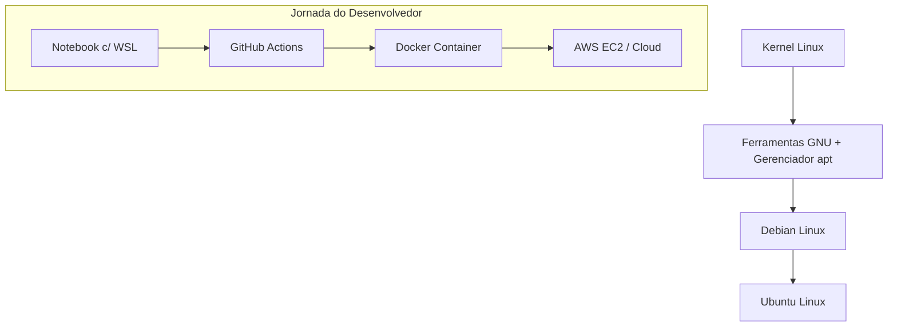

# Introdução ao Linux: Por Que Ele é o Melhor Amigo do Desenvolvedor na Nuvem

Ouvir falar de **Linux** pela primeira vez pode causar um certo receio em quem está começando na área de tecnologia. Afinal, a imagem popularizada costuma ser a de uma tela preta cheia de comandos indecifráveis. No entanto, a realidade moderna é muito mais amigável: o Linux não é um bicho de sete cabeças e se tornou a ferramenta indispensável para qualquer desenvolvedor que deseja construir, implantar e escalar aplicações na nuvem.

Entender o Linux é abrir as portas para o ambiente onde a internet realmente acontece.

---

## 1. O que é o Linux e o conceito de Software Livre / Open Source

### Breve Origem
Em 1991, um estudante finlandês chamado **Linus Torvalds** decidiu criar um núcleo de sistema operacional gratuito e independente. Esse núcleo é o chamado **Kernel Linux** — a peça central que faz a ponte entre o hardware do computador e os programas. Para formar um sistema operacional completo, o Kernel Linux foi combinado com as ferramentas e utilitários do **Projeto GNU** (iniciado por Richard Stallman), dando origem ao ecossistema que conhecemos hoje.

```
┌────────────────────────────────────────────────────────┐
│                   Projeto GNU                          │
│   (Compiladores, Utilitários de Shell, Bibliotecas)   │
└───────────────────────────┬────────────────────────────┘
                            │
                            ┼ ───► Sistema Operacional Completo
                            │      (Linux/GNU)
┌───────────────────────────┴────────────────────────────┐
│                  Kernel Linux                          │
│    (Gerenciamento de Memória, CPU e Hardware)          │
└────────────────────────────────────────────────────────┘
```

### Software Livre e Open Source (Código Aberto)
Diferente de sistemas operacionais proprietários (como Windows ou macOS), o Linux é **Open Source**. Isso significa que o seu código-fonte é totalmente aberto, auditável e público.

* **Transparência e Segurança:** Qualquer pessoa ou empresa pode inspecionar o código para verificar como ele funciona e identificar falhas de segurança.
* **Construção Colaborativa:** Milhares de engenheiros e gigantes da tecnologia — como **AWS, Google, Microsoft e Red Hat** — trabalham juntos aprimorando o sistema continuamente.
* **Liberdade:** Você tem a liberdade de executar, estudar, modificar e redistribuir o software sem custos de licença.

---

## 2. Por que todo desenvolvedor esbarra no Linux?

Se você trabalha ou pretende trabalhar com desenvolvimento de software, eventualmente usará Linux. Isso acontece porque o Linux domina o mundo dos servidores e a infraestrutura moderna por motivos muito claros:

### Leveza e Performance
Servidores em produção não precisam de uma interface gráfica pesada (com janelas, ícones e efeitos visuais). O Linux permite rodar sistemas no modo *headless* (apenas linha de comando), dedicando praticamente **100% da CPU e da memória RAM** para a sua aplicação.

### Custo Zero de Licenciamento e Estabilidade
* **Sem Custos de Licença:** Você pode subir centenas de servidores na nuvem sem pagar licença por cada cópia do sistema operacional.
* **Alta Estabilidade:** Servidores Linux são projetados para durar. É comum encontrar máquinas que ficam ligadas por anos consecutivos sem precisar reiniciar para atualizações simples.

### Nuvem (AWS) e Contêineres (Docker)
O ecossistema moderno de desenvolvimento foi construído sobre o Linux:
* **Nuvem (AWS/GCP/Azure):** Ao criar uma instância na AWS (como um servidor EC2), o ambiente padrão selecionado costuma ser uma distribuição Linux.
* **GitHub Actions:** As esteiras de integração e entrega contínua (CI/CD) executam seus testes e builds predominantemente em ambientes Linux.
* **Docker / Contêineres:** Os contêineres Docker usam recursos nativos do Kernel Linux para isolar aplicações.

---

## 3. Estrutura e Ecossistema Linux

### A Árvore Genealógica: Debian → Ubuntu
Como o Linux é aberto, surgiram várias **Distribuições** (versões customizadas do sistema). Uma das famílias mais importantes é a baseada no **Debian**:

* **Debian:** Conhecido por sua estabilidade extrema e rigor no controle de pacotes. É a base de fundação.
* **Ubuntu:** Criado a partir do Debian, o Ubuntu adicionou facilidade de uso, excelente documentação e forte suporte da comunidade, tornando-se a distribuição mais popular para desenvolvedores e servidores na nuvem.



---

### Guia de Estudo Sem Pressa (WSL)
Se você usa Windows, não precisa formatar seu computador ou criar partições complexas para aprender Linux. O **WSL (Windows Subsystem for Linux)** permite rodar um ambiente Ubuntu nativo diretamente dentro do Windows, com integração total aos seus arquivos e ao VS Code.

---

## 4. Resumo / Principais Pontos de Atenção (Key Takeaways)

* **Linux não é um bicho de sete cabeça:** O terminal é apenas uma forma direta e eficiente de dar instruções ao computador.
* **Open Source é padrão de indústria:** Grandes empresas mantêm o ecossistema Linux por sua segurança, flexibilidade e confiabilidade.
* **Eficiência e economia:** A ausência de interface gráfica em servidores reduz o uso de hardware e elimina custos com licenças.
* **A base da nuvem:** AWS, Docker e GitHub Actions usam Linux como ambiente nativo.
* **Aprenda no seu ritmo:** Use o WSL no Windows para praticar com os comandos básicos de sobrevivência no dia a dia.

---

## 5. Referências e Materiais Recomendados

* [Linux Command Cheat Sheet: 100 Essential Commands (Medium)](https://medium.com/m/global-identity/?redirectUrl=https%3A%2F%2Fjavascript.plainenglish.io%2Flinux-command-cheat-sheet-100-essential-commands-2f3b925f231e)
* ⬅️ **Artigo Anterior:** [`01-sistemas-operacionais.md`](./01-sistemas-operacionais.md)
* ➡️ **Próxima Seção:** [`01-codigo-fonte-e-codigo-de-maquina.md`](../execucao-de-codigo/01-codigo-fonte-e-codigo-de-maquina.md)