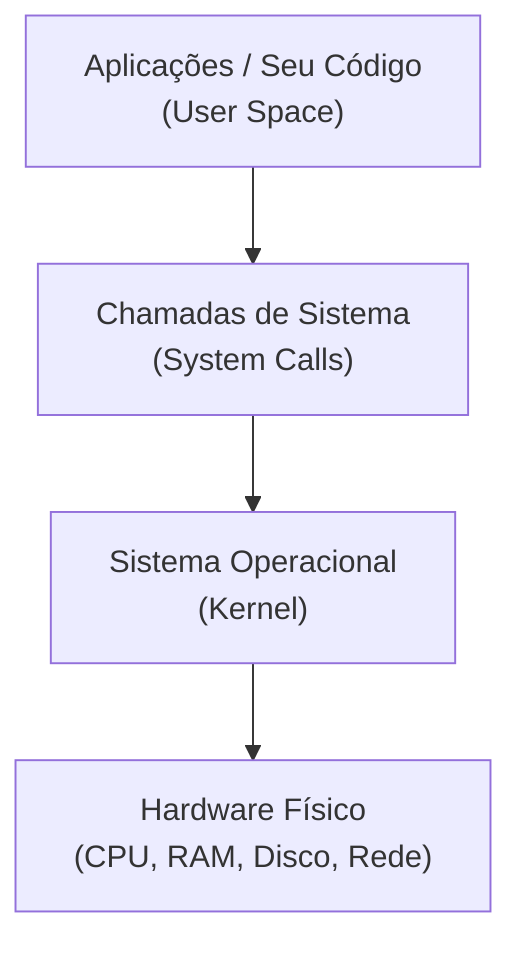
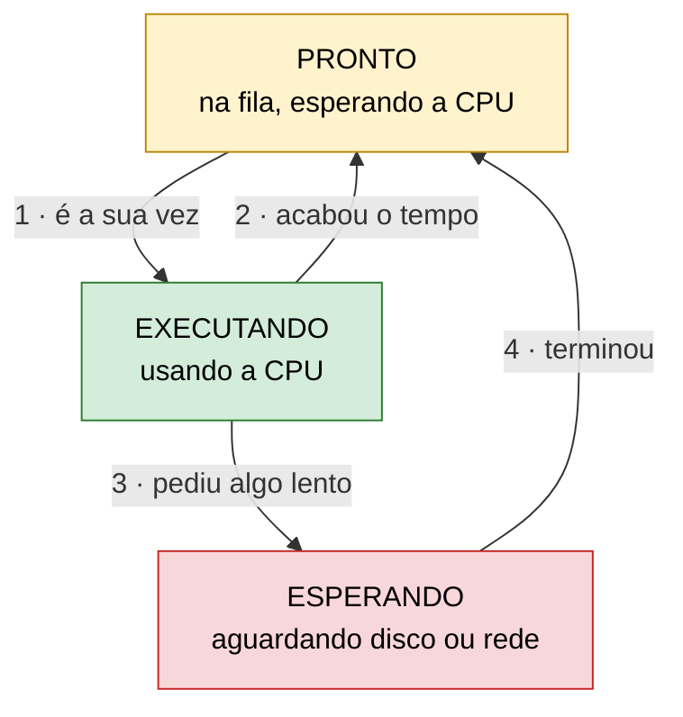
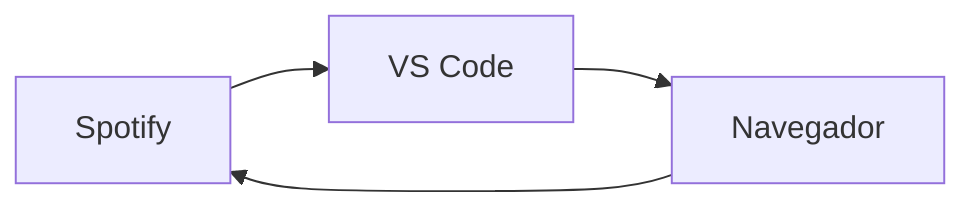

# Sistemas operacionais

Todo código que você escreve, seja um script em Python, uma API em Node.js ou um serviço em Java, roda em cima de um **Sistema Operacional (SO)**. É ele quem decide quanto de CPU e de memória cada programa recebe, quem impede um aplicativo de mexer no outro e quem organiza os arquivos no disco. Entender isso é muito importante porque ele ajuda a explicar por que um programa trava, por que o computador aguenta dezenas de aplicativos abertos ao mesmo tempo e por que existem permissões de arquivo.

Aqui, o SO aparece primeiro como gerente de recursos. Depois vem a divisão entre Kernel e User Space, e por fim os conceitos de programa, processo, multitarefa e sistemas de arquivos.

## 1. Por que seu programa não acessa o hardware diretamente

Para mostrar um `print("Olá, mundo!")` na tela, você não precisa saber qual é a placa de vídeo do computador. Quem cuida disso é o **Sistema Operacional (SO)**, como Windows, Linux, macOS, Android e iOS, que fica entre os programas e a máquina.

Uma boa forma de visualizar é pensar em uma orquestra. Os músicos são como os programas, os instrumentos são o hardware e o SO é o maestro, que decide quem toca, quando toca e por quanto tempo.

### 1.1 O problema sem um SO

Sem um SO, qualquer programa poderia mexer sem limite nenhum na RAM e no disco. Qualquer erro em uma aba do navegador poderia travar o computador inteiro, e um programa malicioso poderia ler a senha aberta em outro aplicativo. Ainda por cima, cada programa teria que conhecer todos os dispositivos existentes para funcionar.

> [!IMPORTANT]
>  O SO existe para que os programas não precisem (e não consigam) mexer no hardware por conta própria. Isso traz praticidade para quem desenvolve e segurança para quem usa.

### 1.2 O SO como maestro e intermediário

O SO fica no meio do caminho entre os programas e o hardware. Todo pedido que um programa faz à máquina passa por ele, e é daí que vêm as três responsabilidades principais, descritas a seguir.

### 1.3 Abstração de hardware (drivers)

Quem desenvolve pede apenas “salve este arquivo” ou “envie este pacote na rede”, sem se preocupar com a marca do SSD ou da placa Wi-Fi. A tradução fica por conta dos **drivers**, pequenos programas que ensinam o SO a conversar com cada dispositivo. Voltando ao exemplo da orquestra, o maestro não precisa saber consertar um violino, basta cada músico saber tocar o seu.

> [!NOTE] 
> É por causa dessa abstração que o mesmo código Python roda em um notebook com SSD da Samsung e em outro com SSD da Kingston, sem alterar nenhuma linha.

### 1.4 Divisão justa de recursos

Com vários programas abertos ao mesmo tempo, a CPU e a memória RAM precisam ser repartidas. O SO decide quanto tempo de CPU e quanto espaço de RAM cada programa pode usar, e assim impede que um único aplicativo consuma tudo e deixe os outros parados.

### 1.5 Isolamento e segurança

Cada programa recebe a sua própria área de memória, e o SO não deixa um invadir a área do outro. Por isso, se o navegador travar, o VS Code continua funcionando, e um aplicativo comum não consegue espiar o que outro guarda na RAM.

---

## 2. Diferença entre Kernel e User Space

Para o isolamento funcionar de verdade, os sistemas modernos dividem o ambiente em duas áreas com níveis de permissão diferentes: o **Kernel** (núcleo) e o **User Space** (espaço do usuário). O diagrama abaixo mostra o caminho que um pedido percorre, de cima para baixo.



> [!IMPORTANT]
>  Seu código nunca fala direto com o hardware. Todo acesso passa pelo Kernel, e é isso que mantém o sistema estável e seguro.

Vale olhar cada camada com calma.

### 2.1 Kernel (Kernel Space)

O Kernel é o coração do SO. Ele roda com acesso total e irrestrito ao hardware físico (CPU, RAM, discos e rede) e é protegido a sete chaves (nenhum aplicativo comum pode alterá-lo diretamente). Um erro dentro dele pode derrubar a máquina inteira, e é justamente por isso que ele fica separado de todo o resto.

### 2.2 User Space

O User Space é a área restrita e segura onde rodam os programas do dia a dia: VS Code, navegador, Spotify, um script em Python ou um servidor Node.js/Java. O acesso aqui é limitado, então um problema em um programa fica contido nele mesmo e não derruba o sistema.

|Característica|Kernel Space|User Space|
|---|---|---|
|**Acesso ao hardware**|Total e direto|Nenhum acesso direto|
|**Quem roda aqui**|Núcleo do SO e drivers|Aplicativos e seu código|
|**Se algo der errado**|Pode travar o computador inteiro|Afeta apenas o próprio programa|
|**Nível de proteção**|Máximo|Restrito|

### 2.3 System Calls: como os dois conversam

Quando um programa no User Space precisa ler um arquivo no SSD, abrir uma porta de rede ou mostrar algo na tela, ele faz um pedido educado e controlado ao Kernel. Esse pedido é a **System Call**.

Pense em um banco. O cliente (User Space) não entra no cofre sozinho, ele faz a solicitação no guichê de atendimento (System Call), e o funcionário autorizado (Kernel) busca o que foi pedido e entrega no balcão.

> [!TIP]
>  Funções comuns das linguagens, como `open()` em Python ou `fs.readFile()` em Node.js, usam System Calls por baixo dos panos. Quase nunca é preciso chamá-las de forma direta, mas elas estão sempre ali.

### 2.4 Um exemplo completo

Ao salvar um arquivo no VS Code, o caminho é este:

1. **Pedido:** o VS Code, que roda no User Space, pede ao SO para gravar o arquivo.
2. **System Call:** o pedido chega ao Kernel por meio de uma chamada de sistema, o "guichê".
3. **Verificação:** o Kernel confere se o programa tem permissão para escrever naquela pasta.
4. **Driver:** o Kernel usa o driver do SSD para traduzir o pedido para a linguagem do dispositivo.
5. **Hardware:** o SSD grava os dados.
6. **Resposta:** o Kernel avisa o VS Code que deu certo, e o editor mostra o arquivo como salvo.

Tudo isso leva uma fração de segundo, e o programa não precisa saber nada sobre o SSD.

---
## 3. Processos, Multitarefa e Arquivos

Até aqui vimos que o SO é o gerente da máquina e que seus programas vivem no User Space, pedindo coisas ao Kernel. Agora vamos responder três perguntas simples:

1. O que está rodando quando eu abro um programa?
2. Como o computador faz vários programas andarem "ao mesmo tempo"?
3. Como o SO organiza o que fica guardado no disco?

### 3.1 Programa vs. Processo

A analogia da cozinha resolve essa confusão:

|Conceito|Analogia|Onde vive|
|---|---|---|
|**Programa**|A **receita** no livro|No SSD, parado|
|**Processo**|O **prato sendo preparado**|Na RAM, em execução|

Uma receita pode gerar vários pratos. Do mesmo jeito, **um programa pode gerar vários processos**: se você abrir o mesmo script Python em dois terminais, terá dois processos independentes.

Para controlar cada processo, o Kernel guarda:

- **PID (Process ID):** o número que identifica o processo.
- **Memória isolada:** um processo não consegue ler nem alterar a memória de outro.
- **Estado:** o que ele está fazendo agora.

#### Os 3 estados de um processo

Um processo não fica sempre executando. Ele alterna entre três estados:



- **Pronto:** na fila, esperando a vez na CPU.
- **Executando:** usando a CPU agora.
- **Esperando:** aguardando algo lento, como disco ou rede. Nesse estado ele não usa a CPU.

> [!TIP]
>  Quando seu código faz uma requisição HTTP ou lê um arquivo, o processo costuma ficar _Esperando_. Isso é a base para entender, mais adiante, operações bloqueantes e assíncronas.

#### Vendo processos na prática

Cada linha do **Gerenciador de Tarefas** (Windows) é um processo. Em código:

```python
import os

print(f"Este script é o processo de PID {os.getpid()}")
```

Rode duas vezes: o PID muda, porque cada execução é um **novo processo**.


### 3.2 Multitarefa e Context Switch

Seu computador tem 4 ou 8 núcleos, mas você mantém música, navegador, VS Code e terminal abertos. Como, se cada núcleo faz **uma coisa por vez**?

O **Escalonador (Scheduler)**, parte do Kernel, resolve isso: ele dá à CPU **um pouquinho de tempo para cada processo**, em fatias de milissegundos, e troca de um para o outro sem parar. É como um garçom atendendo várias mesas: passa tão rápido que todas parecem atendidas ao mesmo tempo.



_A CPU percorre os processos em ciclo, milhares de vezes por segundo._

#### O que é o Context Switch

Para trocar de processo sem perder nada, o SO **salva** onde o processo parou e **restaura** o do próximo. Pense em colocar um marcador no livro antes de pegar outro. Essa troca é a **alternância de contexto (context switch)**.

> [!WARNING]
>  O context switch tem um custo: gasta tempo de CPU. Por isso o computador "engasga" quando há programas demais abertos.


### 3.3 Sistemas de Arquivos

Para o hardware, um SSD é só uma enorme sequência de **zeros e uns**. Não existem "pastas" nem "nomes de arquivo" lá. Quem cria essa organização é o **sistema de arquivos**, que funciona como o **catálogo de uma biblioteca**: sem ele, os livros existem, mas ninguém acha nada.

Ele oferece:

- **Pastas e arquivos**, em forma de árvore (`/home/maria/projetos/app.py`).
- **Extensões** (`.py`, `.md`, `.jpg`), que indicam o tipo de conteúdo.
- **Permissões:** quem pode ler (`r`), escrever (`w`) ou executar (`x`).

|Sistema de arquivos|Onde é usado|
|---|---|
|**ext4**|Linux|
|**NTFS**|Windows|
|**APFS**|macOS e iOS|

Cada um organiza o disco de um jeito, mas todos entregam a mesma ideia ao programador. Seu código chama `open("dados.txt")` sem saber qual sistema de arquivos está por baixo.

#### Permissões na prática

No Linux/macOS, o comando `ls -l` mostra as permissões:

```bash
$ ls -l script.sh
-rwxr-xr-- 1 maria devs 120 nov 11 22:00 script.sh
```

O trecho `rwxr-xr--` se divide em três grupos:

|Trecho|Quem|Pode|
|---|---|---|
|`rwx`|Dono (`maria`)|Ler, escrever e executar|
|`r-x`|Grupo (`devs`)|Ler e executar|
|`r--`|Todos os outros|Só ler|

Para dar permissão de execução:

```bash
chmod +x script.sh
```

> [!TIP] 
> O erro `Permission denied` aparece quando o Kernel confere as permissões e nega o acesso. É o sistema de segurança funcionando.


## Principais pontos de atenção (Key Takeaways)

- O **SO** fica entre os programas e o hardware: ele abstrai os dispositivos (drivers), divide CPU e RAM entre os programas e garante isolamento e segurança.
- Programas **não acessam o hardware diretamente**, e isso evita que um erro em um aplicativo derrube a máquina ou exponha dados de outro.
- O **Kernel** roda com acesso total ao hardware, e o **User Space** é a área restrita onde rodam os aplicativos do dia a dia.
- A conversa entre os dois acontece por **System Calls**, como o cliente que faz o pedido no guichê em vez de entrar no cofre.
- **Programa** é o código parado no disco (a receita), e **processo** é o programa em execução na RAM, com PID, memória isolada e estado próprio (o prato sendo preparado).
- A **multitarefa** funciona porque o **escalonador** (_scheduler_) alterna entre os processos em frações de milissegundos (_context switch_).
- Os **sistemas de arquivos** (ext4, NTFS, APFS) montam a organização de pastas, arquivos e permissões em cima dos zeros e uns do disco.

## Referências e materiais recomendados

- Harvard CS50's Understanding Technology, Week 1: Hardware: [https://cs50.harvard.edu/technology/](https://cs50.harvard.edu/technology/)