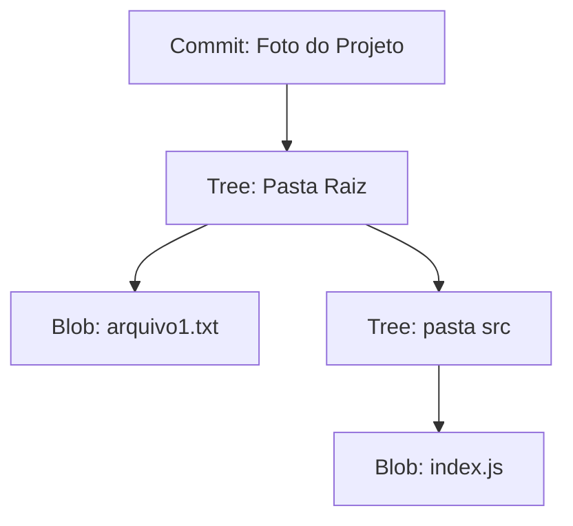

# 02. `Como o Git Funciona por Baixo dos Panos`

## 📖 Visão Geral

Para utilizar o Git com maestria, é fundamental entender o seu **modelo**. Enquanto a maioria dos sistemas de controle de versão tradicionais enxerga os arquivos como conjuntos de diferenças ao longo do tempo (*deltas*), o Git opera de forma completamente diferente: ele trabalha com **fotografias instantâneas (*snapshots*)** do projeto.

Compreender como o Git armazena dados de forma segura através de hashes e objetos internos desmistifica o funcionamento da ferramenta e evita receios comuns no dia a dia do desenvolvimento.

---

## 📸 Snapshots vs. Deltas

A principal diferença entre o Git e sistemas mais antigos (como SVN e CVS) está no modo como os dados são visualizados e armazenados:

### Sistemas Tradicionais (Baseados em Deltas)
* Guardam um arquivo inicial e, a cada alteração, registram apenas a lista de modificações de texto (*diffs* ou *deltas*) aplicadas sobre ele.
* **Desvantagem:** Para reconstruir o arquivo em um determinado ponto da história, o sistema precisa processar sequencialmente todas as diferenças acumuladas desde a versão inicial.

### O Modelo do Git (Baseado em Snapshots)
* A cada *commit*, o Git tira uma "foto" completa do estado de todos os arquivos do repositório naquele momento.
* **Vantagem:** Para evitar duplicar dados desnecessariamente, se um arquivo não sofreu alterações entre um commit e outro, o Git não salva o arquivo novamente. Em vez disso, ele cria apenas um **ponteiro (link)** apontando para a cópia idêntica já armazenada anteriormente.

| Característica | Armazenamento por Deltas | Armazenamento por Snapshots (Git) |
| :--- | :--- | :--- |
| **Abordagem** | Guarda alterações de texto acumuladas | Guarda fotografias do estado completo |
| **Arquivos inalterados** | Não afeta o delta | Reaproveita ponteiros para a cópia existente |
| **Velocidade de restauração** | Lenta (recalcula histórico de deltas) | Instantânea (acessa o snapshot diretamente) |

---

## 🔐 Criptografia e Integridade: O Papel dos Hashes SHA

Tudo no Git é checado e identificado por um código alfanumérico único de 40 caracteres chamado **hash SHA** (especificamente *SHA-256*).

O hash é gerado matematicamente com base no conteúdo exato do arquivo ou estrutura. Isso garante duas propriedades cruciais:

1. **Integridade Imutável:** É impossível alterar o conteúdo de um arquivo ou uma mensagem de commit sem alterar o seu código hash. Se um único caractere mudar, o hash muda completamente.
2. **Rastreabilidade Criptográfica:** O Git percebe imediatamente qualquer corrupção de arquivo no disco ou alteração não autorizada no histórico.

> 💡 **Exemplo de Hash SHA-1:** `8a2f1b4c3d5e6f7a8b9c0d1e2f3a4b5c6d7e8f9a`  
> Na prática diária, você só precisa utilizar os **7 primeiros caracteres** para identificar um commit (ex: `8a2f1b4`).
>
> Proteção do Git: Se por acaso esses 7 caracteres forem iguais aos de outro commit no mesmo projeto, o Git avisará e solicitará que insira mais alguns caracteres. Em projetos gigantescos como o Kernel do Linux, costuma-se usar de 10 a 12 caracteres por segurança.

---

## 📦 Os 4 Objetos Internos do Git

Por baixo dos panos, o Git funciona como um banco de dados simples de chave-valor armazenado no diretório oculto `.git/objects`. Tudo no repositório é representado por quatro objetos fundamentais:

### 1. `blob` (*Binary Large Object*)
* Armazena **apenas o conteúdo de um arquivo**, sem guardar o seu nome, permissões ou data de criação.
* Se dois arquivos em pastas diferentes tiverem exatamente o mesmo conteúdo, o Git guarda apenas 1 `blob`.

### 2. `tree` (*Árvore / Diretório*)
* Corresponde a uma pasta do sistema.
* Funciona como um índice que organiza os `blobs` e subpastas (`trees`), associando cada um aos seus respectivos nomes de arquivos entre outros metadados.

### 3. `commit` (*Snapshots e Histórico*)
* Representa o estado do projeto em um determinado instante.
* Contém um ponteiro para a `tree` principal (a pasta raiz), os dados do autor/comitente, a data, a mensagem explicativa e o hash do(s) **commit(s) pai(s)**, formando a cadeia do histórico.

### 4. `tag` (*Marcador de Versão*)
* Um ponteiro fixo e amigável que aponta para um `commit` específico (geralmente usado para marcar versões de lançamento, como `v1.0.0`).

### 📊 Representação Visual da Árvore de Objetos

O diagrama abaixo ilustra como o Git organiza os objetos internos para representar uma pasta de projeto real:

---

## 🔗 Próximos Passos

>Agora que você compreende como o Git fotografa e organiza os objetos internamente, veja como os seus arquivos trafegam pelas áreas de trabalho no fluxo diário:

* [01. Sistemas de Controle de Versão](01-sistemas-de-controle-de-versao.md)
* [03. Zonas e Ciclo de Vida de Arquivos](03-zonas-e-ciclo-de-vida-de-arquivos.md)
---