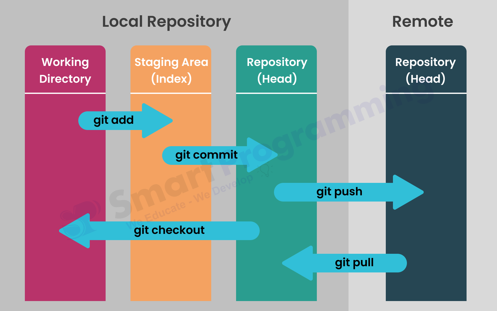

# 03. `Zonas e Ciclo de Vida de Arquivos`

## 📖 Visão Geral

Para trabalhar com o Git de forma confiável, é indispensável compreender onde os seus arquivos estão localizados no sistema e qual é o estado de cada um em determinado momento. 

Ao contrário de um sistema de arquivos comum do sistema operacional, o Git divide o seu ambiente de desenvolvimento em **quatro zonas distintas** e classifica os arquivos em **quatro estados possíveis**. Esse controle rígido garante que nenhuma alteração seja salva no histórico sem a intenção explícita do desenvolvedor.

---

## 🗺️ As 4 Zonas de Trabalho do Git

O fluxo de dados no Git acontece através da movimentação de arquivos entre quatro áreas fundamentais:

1. **Working Directory (Diretório de Trabalho):** É a pasta física no seu computador onde você cria, edita e apaga os arquivos do projeto. É o seu ambiente ativo de código.
2. **Staging Area / Index (Área de Preparação):** Uma zona intermediária (um arquivo interno localizado em `.git/index`) que armazena o rascunho exato do que fará parte do próximo *snapshot*.
3. **Local Repository (Repositório Local):** O banco de dados do Git salvo na sua própria máquina (pasta `.git`). É onde os commits ficam gravados de forma permanente no seu histórico.
4. **Remote Repository (Repositório Remoto):** O repositório hospedado em um servidor na nuvem (como o GitHub ou GitLab), utilizado para compartilhar código e colaborar com a equipe.

---

## 🔄 Os 4 Estados de um Arquivo

Dentro do seu diretório de trabalho, cada arquivo é rastreado pelo Git e se enquadra em uma das quatro categorias do seu ciclo de vida:

| Estado | Nome em Inglês | Descrição |
| :--- | :--- | :--- |
| **Não Rastreado** | *Untracked* | Arquivo recém-criado na pasta do projeto que o Git ainda não monitora. |
| **Não Modificado** | *Unmodified* | Arquivo já rastreado pelo Git que não sofreu alterações desde o último commit. |
| **Modificado** | *Modified* | Arquivo rastreado que teve seu conteúdo alterado, mas cujas mudanças ainda não foram preparadas. |
| **Preparado** | *Staged* | Arquivo modificado marcando presença na *Staging Area*, pronto para ser incluído no próximo commit. |

---

## 📊 Diagrama de Fluxo de Comandos e Transições

* O diagrama a seguir demonstra como os arquivos transitam entre as zonas de trabalho ao executar os comandos fundamentais do Git:

#### Entendendo a movimentação dos comandos na imagem:

* **`git add`**: Seleciona as alterações feitas no *Working Directory* e envia-as para a *Staging Area*.
* **`git commit`**: Regista as alterações da *Staging Area* e grava-as permanentemente no *Local Repository*.
* **`git push`**: Envia os commits do *Local Repository* para atualizar o *Remote Repository* (GitHub).
* **`git checkout`**: Recupera ficheiros ou alterna entre estados do *Local Repository* diretamente para o *Working Directory*.
* **`git pull`**: Sincroniza e descarrega as alterações do *Remote Repository* para o repositório local.
> 💡 **Boa Prática:** Sempre utilize o comando `git status` antes de rodar `git add` ou `git commit`. Ele exibe um raio-X instantâneo de em qual zona e estado cada arquivo se encontra!

#### 🛠️ Comandos complementares de restauração:

* **`git restore --staged <ficheiro>`**: Remove o ficheiro da *Staging Area* e devolve-o para o *Working Directory*, mantendo o teu código intacto.
* **`git restore <ficheiro>`**: Descarta as alterações não salvas no *Working Directory*, restaurando o ficheiro para o estado do último commit.

---

## 🔗 Próximos Passos

Aprenda agora como configurar a sua assinatura de autor e ajustar as opções de rastreabilidade para garantir commits seguros e identificáveis:

* [02. Como o Git Funciona por Baixo dos Panos](02-como-o-git-funciona-por-baixo-dos-panos.md)
* [04. Configuração, Rastreabilidade e Identidade](04-configuracao-rastreabilidade-e-identidade.md)
---