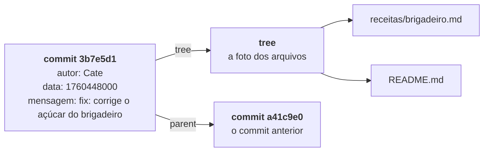

# Anatomia de um Commit e conventional Commits

> **Objetivo:** entender o que o Git guarda em cada commit e como escrever commits claros, pequenos e padronizados.

## Para uma melhor contextualização

Ao rodar `git commit`, o Git pega o que está na staging area e grava como um **commit**. O histórico do projeto é a sequência desses commits, e o `git log` mostra justamente essa sequência. Os exemplos deste arquivo usam um projeto hipotético do dia a dia das pessoas: o **site de receitas da família**.

```
git log --oneline
```

```
   3b7e5d1 fix: corrige a quantidade de açúcar do brigadeiro
   a41c9e0 feat: adiciona a receita de bolo de cenoura
   c08f2b4 chore: cria a estrutura inicial do site
```

Cada linha é um commit, com o hash abreviado e a mensagem. Quanto melhor escritos forem os commits, mais fácil fica entender e usar o histórico para quem precisa revisar ou desfazer algo.

---

## 1. Anatomia de um commit

O conteúdo bruto de um commit pode ser visto com:

```
git cat-file -p HEAD
```

```
tree 9f2c1a7d4e8b3c5a6f0d1e2b3a4c5d6e7f8a9b0c
parent a41c9e0d5b8f3c2e7a6d1b0f4e9c8a7d3b2f1e60
author Cate <cate@exemplo.com> 1760448000 -0300
committer Cate <cate@exemplo.com> 1760448000 -0300

fix: corrige a quantidade de açúcar do brigadeiro
```

### Os elementos

1. **Hash:** o "número de série" do commit, com 40 caracteres hexadecimais, é calculado a partir de todo o conteúdo dele. Nos comandos, a forma abreviada acaba funcionando (`git show 3b7e5d1`).
2. **Autor:** quem escreveu a alteração (linha `author`), com nome e e-mail. No exemplo, foi a Cate.
3. **Data:** é o que mostra quando o commit foi feito. Fica guardado junto com o autor, em formato numérico (`1760448000 -0300`), e o `git log` mostra de forma legível.
4. **Mensagem explicativa:** é como um bilhete deixado no commit (fica logo depois da linha em branco). A primeira linha é o resumo e o restante é o corpo, que é opcional.
5. **Ponteiro para o commit pai:** a linha `parent`, que aponta para o commit anterior. É ela que liga os commits em uma linha do tempo. O primeiro commit do repositório não tem pai, e um commit de merge tem dois.

### Por que o pai importa?
Bom, o hash é calculado usando, entre outras coisas, o `parent`. Por isso, alterar um commit antigo muda o hash dele e, por consequência, o de todos os commits que viriam depois.

---

## 2. Princípio do commit atômico

Um **commit atômico** guarda uma única mudança lógica e completa, com um só assunto.

**Como identificar um commit misturado:** quando o resumo do commit precisa da palavra ‘e’ para ligar ações diferentes, provavelmente existem assuntos misturados e o commit deve ser dividido.

```
# misturado: um commit só, três assuntos
feat: adiciona bolo de cenoura, corrige o açúcar do brigadeiro e atualiza o README

# atômico: três commits, um assunto em cada
feat: adiciona a receita de bolo de cenoura
fix: corrige a quantidade de açúcar do brigadeiro
docs: explica no README como enviar uma receita nova
```
### Por que commits pequenos e com escopo único ajudam

|Situação|Vantagem do commit atômico|
|---|---|
|**Revisão de código**|Quem revisa lê uma mudança de cada vez, com o contexto claro.|
|**Reversão de bugs**|O `git revert <hash>` desfaz só a mudança com problema, sem levar junto outras alterações.|
|**Localização de bugs**|O `git bisect` encontra o commit que introduziu o erro, e quanto menor o commit, mais precisa é a resposta.|

> ⚠️**PSIU!!**  quando um mesmo arquivo tem alterações de assuntos diferentes, o `git add -p` permite escolher trecho por trecho o que entra em cada commit.

---

## 3. Conventional Commits e boas práticas

O **Conventional Commits** é um padrão semântico para mensagens de commit. Com ele, pessoas e ferramentas leem o histórico do mesmo jeito.
### 3.1 Estrutura


### 3.2 Tipos

| Tipo       | Quando usar                                | Exemplo                                                       |
| ---------- | ------------------------------------------ | ------------------------------------------------------------- |
| `feat`     | Funcionalidade nova                        | `feat: adiciona a receita de bolo de cenoura`                 |
| `fix`      | Correção de bug                            | `fix: corrige a quantidade de açúcar do brigadeiro`           |
| `docs`     | Mudança só na documentação                 | `docs: explica no README como enviar uma receita nova`        |
| `style`    | Formatação, sem mudar o conteúdo           | `style: padroniza os títulos das receitas`                    |
| `refactor` | Reorganização, sem novidade e sem correção | `refactor: separa as receitas em pastas por categoria`        |
| `test`     | Criação ou ajuste de testes                | `test: confere se toda receita tem lista de ingredientes`     |
| `chore`    | Manutenção e tarefas de apoio              | `chore: renomeia os arquivos de fotos para letras minúsculas` |

### 3.3 Escopo opcional

O escopo vai entre parênteses logo depois do tipo e indica a parte do sistema afetada:

```
feat(sobremesas): adiciona o pudim de leite
fix(salgados): corrige o tempo de forno da coxinha
docs(readme): inclui seção de contato
```

### 3.4 Quebras de compatibilidade (breaking changes)

Uma **breaking change** é uma mudança que obriga quem já usa o projeto a se adaptar. Vale falar que ela deve ser sinalizada de uma destas formas (ou das duas juntas):

- `!` logo depois do tipo ou do escopo;
- rodapé começando com `BREAKING CHANGE:`.

```
feat(receitas)!: troca as medidas de xícara por gramas

BREAKING CHANGE: todas as receitas agora usam gramas.
```

> **Contexto:** no versionamento semântico (`MAJOR.MINOR.PATCH`), uma breaking change gera uma versão MAJOR, um `feat` gera uma MINOR e um `fix` gera uma PATCH. É por isso que ferramentas de release automático leem essas mensagens.

### 3.5 Redação no imperativo

Na redação no imperativo, a descrição do commit deve completar a frase “Se aplicado, este commit irá...”, então o verbo fica na forma de ordem (“corrige”, “adiciona”) e não no passado ou no gerúndio. Também convém evitar descrições vagas e dizer exatamente o que mudou.
### 3.6 Outras boas práticas

1. Resumo com até cerca de 50 a 72 caracteres, sem ponto final.
2. Linha em branco entre o resumo e o corpo.
3. O corpo explica o **porquê** da mudança, porque o **o quê** já está no código.
4. O rodapé pode referenciar tarefas, como `Closes #42`.

---

[← Anterior: 04 - Configuração e identidade](04-configuracao-rastreabilidade-e-identidade.md) | [Próximo: 06 →](<06-branches-e-ponteiros-head.md>)
