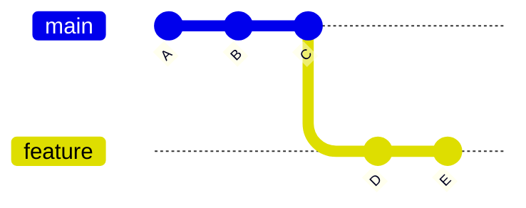

# branches e ponteiros head

>**Objetivo:** entender o que é uma branch por baixo dos panos, como o Git sabe onde o desenvolvedor está e o que fazer no estado de Detached HEAD. 

## Para ambientar

Em um projeto, a branch `main` guarda a versão estável/principal do código. Para criar uma funcionalidade ou corrigir um bug sem ter um risco de afetar diretamente a branch main, o Git permite criar uma **branch**. Uma branch é uma ramificação do trabalho que está acontecendo em paralelo, que só chega à `main` quando fica pronta e é integrada. No site de receitas, a Cate usa uma branch para criar a seção de sobremesas sem mexer no livro oficial.

```
git switch -c feature-sobremesas   # cria a branch de rascunho e entra nela
# ... adiciona receitas e faz commits ...
git switch main                    # volta para o livro oficial, sem as sobremesas pela metade
```

---

## 1. O que é uma branch na prática

Uma branch é um **ponteiro móvel e leve** que aponta para o commit mais recente de uma linha de trabalho. Porém, não existe cópia dos arquivos: o ponteiro só diz "a versão mais recente desta linha está aqui".

Fisicamente, é um arquivo de texto em `.git/refs/heads/` que guarda o hash do commit:

```
cat .git/refs/heads/main
# 9f2c1a7d4e8b3c5a6f0d1e2b3a4c5d6e7f8a9b0c
```

O hash tem 40 caracteres, mais a quebra de linha no fim do arquivo, o que dá **41 bytes**. Por isso criar e trocar de branch é instantâneo.



No site de receitas, o diagrama representa:

| Commit | O que aconteceu                                     |
| ------ | --------------------------------------------------- |
| A      | Receitas básicas do site                            |
| B      | Receita de feijoada adicionada                      |
| C      | Sal da feijoada corrigido                           |
| D e E  | Pudim e brigadeiro, adicionados na branch `feature` |

A `main` aponta para o commit C e a `feature` aponta para o commit E. Quando um commit novo é feito, o Git move o ponteiro da **branch ativa** para ele, e as outras branches ficam onde estavam.

### Comandos principais

|Comando| O que faz                                   |
| -------------------- | ------------------------------------------- |
|`git branch`| Lista as branches locais                    |
|`git branch nome`| Cria a branch, sem entrar nela              |
|`git switch nome`| Troca para a branch                         |
|`git switch -c nome`| Cria e troca para a branch                  |
|`git branch -d nome`| Apaga o ponteiro de uma branch já integrada |

> ⚠️**PSIU!!!:** o `git checkout` também troca de branch e aparece em muitos tutoriais. O `git switch` foi criado depois, para deixar essa tarefa mais clara.

---

## 2. O papel do ponteiro HEAD

Com várias branches no projeto, o Git precisa saber em qual delas o trabalho está acontecendo. Essa informação fica no **HEAD**.

Normalmente, o HEAD não aponta direto para um commit. Ele aponta para uma branch, e a branch aponta para um commit:

```
cat .git/HEAD
# ref: refs/heads/main
```

```
HEAD  →  main  →  commit C
```

### Como o Git usa essa cadeia

1. Ao fazer um commit, o Git lê o HEAD e descobre que ele aponta para a `main`.
2. Cria o commit novo, tendo o commit C como pai.
3. Move a `main` para o commit novo. O HEAD continua apontando para a `main`.

Ao trocar de branch com `git switch feature`, o que muda é o conteúdo do HEAD, e o Git atualiza os arquivos para refletir aquela branch. 

### O HEAD como referência no histórico

| Expressão           | Significado         |
| ------------------- | ------------------- |
| `HEAD`              | Commit atual        |
| `HEAD~1` ou `HEAD^` | Pai do commit atual |
| `HEAD~3`            | Três commits atrás  |

```
git show HEAD~2     # mostra o que foi feito dois commits atrás
```

---

## 3. O estado de Detached HEAD

### 3.1 O que é

No **Detached HEAD** (HEAD "solto"), o HEAD aponta **direto para um commit**, sem passar por uma branch.

```
Normal:    HEAD → main → commit C

Detached:  HEAD → commit B        (a main continua no commit C)
```

Nesse estado, o repositório fica posicionado em um commit antigo, que existe e pode ser consultado, mas não faz parte de nenhuma branch, ou seja, não acompanha a linha de trabalho que está sendo atualizada.
### 3.2 Quando ocorre

Quando se faz checkout de um commit avulso ou de uma tag:

```
git checkout 3b7e5d1         # vai para o estado do site naquele commit
git checkout v1.0.0          # vai para a versão marcada como v1.0.0 (a primeira edição)
git switch --detach HEAD~2   # vai para dois commits atrás, de forma explícita
```

O Git avisa que o repositório está em "detached HEAD". Isso não é um erro.

**Exemplo:** uma moça diz que a receita do pudim da primeira edição era melhor. Para conferir, o desenvolvedor faz checkout da tag `v1.0.0` e lê a receita exatamente como era naquela época.
### 3.3 O risco
Commits feitos nesse estado não pertencem a nenhuma branch. Se houver troca de branch sem guardar o trabalho, eles ficam órfãos, sem nenhuma referência apontando para eles, e podem ser apagados pela limpeza automática do Git depois de um tempo.
### 3.4 Como voltar com segurança

**Caso 1: só olhou, sem fazer commits.** Basta voltar para a branch.

```
git switch main
```

**Caso 2: fez commits e quer guardá-los**.
Criar uma branch na posição atual, antes de sair, para que esses commits passem a pertencer a ela. Por exemplo, se a medida do pudim foi corrigida em detached HEAD.

```
git switch -c correcao-pudim
```

**Caso 3: já saiu e os commits parecem ter sumido**
O `git reflog` lista as posições recentes do HEAD, e a partir do hash dá para criar uma branch.

```
git reflog
```

```
7d2e4f1 HEAD@{0}: checkout: moving from 3b7e5d1 to main
5a9c3e8 HEAD@{1}: commit: corrige a medida do pudim
3b7e5d1 HEAD@{2}: checkout: moving from main to 3b7e5d1
```

O commit `5a9c3e8` é o conserto que parecia perdido. Para recuperá-lo:

```
git switch -c recuperado 5a9c3e8
```
---
[← Anterior: 05 - Anatomia de um commit](05-anatomia-de-um-commit-e-conventional-commits.md) | [Próximo: 07 - Merge vs Rebase →](07-estrategias-de-integracao-merge-vs-rebase.md)