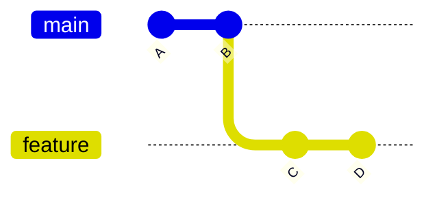
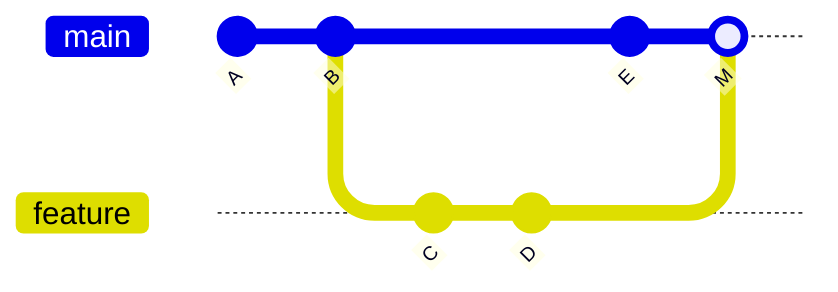
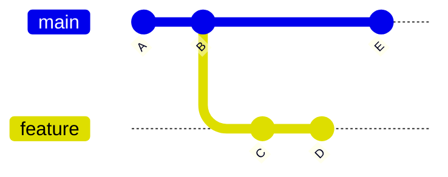
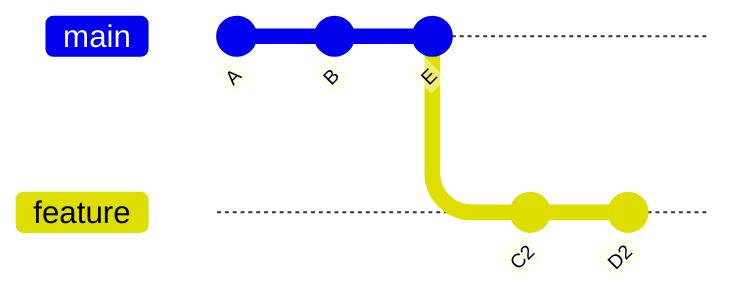

# estrategias de integração merge vs rebase

> **Objetivo:** entender as duas formas de levar o trabalho de uma branch para outra, o que cada uma faz com o histórico e quando usar cada uma.
## Para ambientar
Quando duas branches avançam em paralelo, o trabalho de uma precisa, em algum ponto, chegar na outra. O Git oferece duas estratégias para que isso possa acontecer:

- **Merge:** junta as duas linhas de histórico.
- **Rebase:** reaplica os commits de uma branch no topo da outra.

O conteúdo dos arquivos é o mesmo nos dois casos, o que realmente muda é o **histórico**.

Nos diagramas que irão aparecer, `A` e `B` são a base comum, `C` e `D` são commits da `feature` e `E` é um commit novo na `main`.

---

## 1. Fast-Forward merge vs 3-Way merge

O comando é o mesmo nos dois casos. Quem decide o comportamento é o formato do histórico.

```
git switch main
git merge feature
```

### 1.1 Fast-Forward

Ocorre quando a `main` **não recebeu commits novos** desde que a `feature` foi criada. Como o caminho é reto, o Git só faz mover o ponteiro da `main` para a frente. **Nenhum commit novo é criado.**

Antes do merge:



Depois do `git merge feature`, a `main` aponta para o D e o histórico segue linear: `A ← B ← C ← D`.

### 1.2 3-Way Merge (com merge commit)

Acontece quando as duas branches **avançaram separadas**. O Git compara três pontos: o último ancestral comum (B) e as pontas das duas branches (E e D). Com base nisso, cria um **merge commit**, que tem dois pais.



O commit `M` é o merge commit, com o `E` (da `main`) e o `D` (da `feature`) como pais. O histórico preserva o que aconteceu de fato: duas linhas paralelas que se encontraram.

### 1.3 Conflitos

Se as duas branches alteraram a **mesma linha** do mesmo arquivo, o Git não decide sozinho. Ele interrompe o merge e marca as duas versões no arquivo:

```
<<<<<<< HEAD
versão da branch atual
=======
versão da branch que está sendo integrada
>>>>>>> feature
```

Para resolver:

1. Editar o arquivo e escolher a versão que fica.
2. Apagar as marcações (`<<<<<<<`, `=======` e `>>>>>>>`).
3. Rodar `git add <arquivo>`.
4. Concluir com `git commit`.

Para desistir no meio do caminho, vale `git merge --abort`.

---

## 2. Rebase linear

O **rebase** reaplica os commits da branch, um por vez, no topo de outra branch, deixando o histórico linear.

```
git switch feature
git rebase main
```

Antes do rebase, a `feature` saiu do commit B e a `main` já avançou até o E:



Depois do rebase, a `feature` parte do E:


### Como o Git faz isso

1. Localiza o ancestral comum (B).
2. Guarda as alterações de C e D.
3. Move a base da `feature` para o commit E.
4. Reaplica as alterações, uma de cada vez, criando commits novos (`C2` e `D2`).

Os commits `C2` e `D2` têm o mesmo conteúdo de C e D, mas **hashes diferentes**, porque o pai mudou. Por conta disso, o rebase **reescreve o histórico** da branch.

Para finalizar, a `main` avança por Fast-Forward, sem merge commit:

```
git switch main
git merge feature
```

> **Conflitos no rebase:** como os commits são reaplicados um a um, o conflito pode aparecer em cada etapa. Depois de resolver, vale `git rebase --continue`. Para cancelar, `git rebase --abort`.

---

## 3. Comparativo prático

|Critério|Merge|Rebase|
|---|---|---|
|**Formato do histórico**|Factual, com ramificações e merge commits|Limpo e linear|
|**Commits originais**|Mantidos|Reescritos, com hashes novos|
|**Leitura do `git log`**|Mais ramificado, pode poluir em projetos movimentados|Uma linha reta, fácil de ler|
|**Conflitos**|Resolvidos uma vez, no merge commit|Possivelmente em cada commit reaplicado|
|**Segurança**|Não destrutivo|Reescreve histórico, exige cuidado|
|**Uso típico**|Integrar branches compartilhadas|Atualizar uma branch pessoal com a `main`|

---

## ⚠️ PSIUUUU!

> **NUNCA execute rebase em branches públicas, compartilhadas com a equipe.**

O rebase cria commits novos e abandona os antigos. Se outras pessoas já baixaram os antigos, o histórico delas passa a divergir do remoto. O problema acontece em quatro passos:

1. Uma pessoa faz rebase da branch compartilhada e envia com `git push --force`.
2. O remoto passa a ter os commits novos (`C2` e `D2`).
3. Outra pessoa ainda tem os antigos (C e D) e continua trabalhando em cima deles.
4. Ao integrar, o Git encontra duas versões do mesmo trabalho, o que gera conflitos repetidos e commits duplicados.

Por isso, o rebase fica restrito a commits **ainda não enviados** ou a branches de uso pessoal.

---

[← Anterior: 06 - Branches e HEAD](06-branches-e-ponteiros-head.md) | [Próximo: 08 - O arquivo .gitignore →](08-o-arquivo-gitignore.md)