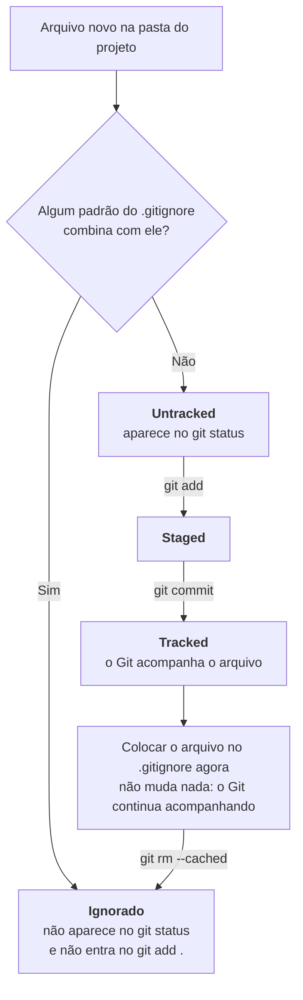

# o arquivo gitignore

> **Objetivo:** entender por que alguns arquivos não devem entrar no repositório, como escrever os padrões do `.gitignore` e como corrigir o problema quando um arquivo foi commitado por engano.

## Para ambientar
Para o Git, um arquivo do projeto pode estar em dois estados principais:
- **Tracked (rastreado):** o Git já acompanha o arquivo.
- **Untracked (não rastreado):** o Git ainda não conhece o arquivo, e ele aparece no `git status` como candidato a entrar no próximo commit.

O **`.gitignore`** é um arquivo de texto, normalmente na pasta principal do projeto, que lista os padrões de arquivos e pastas que o Git deve ignorar. Vale comentar que arquivos ignorados não aparecem como _untracked_ e não entram em um `git add .`. Como o próprio `.gitignore` é versionado, a regra vale para toda a equipe.


---

## 1. Por que e o que ignorar

|Categoria|Por que ignorar|Exemplos|
|---|---|---|
|**Senhas e credenciais**|Repositórios são clonados e muitas vezes públicos, e chaves expostas são encontradas e usadas rapidamente por robôs|`.env`, `*.pem`, `*.key`, `secrets.json`|
|**Diretórios pesados**|Podem ser recriados com um comando e ocupam muito espaço|`node_modules/`, `venv/`, `vendor/`|
|**Arquivos compilados**|Podem ser gerados de novo a partir do código-fonte|`dist/`, `build/`, `*.pyc`, `__pycache__/`|
|**Lixo de IDE e do sistema**|Configurações pessoais geram ruído e conflitos entre a equipe|`.idea/`, `.vscode/`, `.DS_Store`|

> **Boa prática:** versionar um arquivo `.env.example`, com os nomes das variáveis e sem os valores reais, e manter o `.env` verdadeiro fora do repositório. O mesmo vale para as dependências: vai para o repositório o arquivo que as lista (`package.json`, `requirements.txt`), e cada pessoa instala o restante na própria máquina.

---

## 2. Sintaxe de padrões glob

O arquivo é lido linha por linha, e cada linha é um padrão.

|Padrão|Significado|Exemplo|
|---|---|---|
|`#`|Comentário|`# Dependências`|
|`*`|Qualquer sequência de caracteres, exceto `/`|`*.log` ignora `erro.log` e `acesso.log`|
|`?`|Exatamente um caractere|`foto?.jpg` ignora `foto1.jpg`, mas não `foto10.jpg`|
|`**`|Qualquer quantidade de pastas|`**/logs` ignora `logs/` em qualquer nível|
|`nome/`|Barra no final: vale só para diretórios|`logs/` ignora a pasta e tudo que há dentro dela|
|`/nome`|Barra no início: vale só na raiz do projeto|`/build` ignora o `build/` da raiz, mas não `src/build/`|
|`!`|Negação: traz de volta algo ignorado|`*.log` com `!importante.log` ignora todos os logs, menos o `importante.log`|

Exemplo de arquivo completo:

```
# Dependências
node_modules/
venv/

# Segredos
.env
!.env.example

# Build
dist/
build/

# IDE e sistema
.idea/
.DS_Store

# Logs
*.log
!importante.log
```

### Cuidado com a negação

Não é possível reincluir um arquivo se a **pasta** que o contém foi ignorada, porque o Git nem entra na pasta. Nesse caso, a regra deve ignorar o conteúdo da pasta, e não a pasta:

```
# Não funciona
logs/
!logs/importante.log

# Funciona
logs/*
!logs/importante.log
```

> **Dica:** quando um arquivo não está sendo ignorado como esperado, o comando `git check-ignore -v caminho/do/arquivo` mostra qual regra está valendo.

---
## 3. Correção de incidentes

### 3.1 O problema

O `.gitignore` **só vale para arquivos ainda não rastreados**. Se o arquivo já foi commitado, o Git continua acompanhando ele, mesmo depois de a regra ser adicionada.
### 3.2 A solução: `git rm --cached`

O `git rm --cached` remove o arquivo do **índice** (staging area) e **mantém o arquivo no disco**. Com isso, o Git deixa de rastrear.

```
# 1. adicionar a regra
echo ".env" >> .gitignore

# 2. desrastrear o arquivo, sem apagar do disco
git rm --cached .env

# 3. registrar a correção
git add .gitignore
git commit -m "chore: remove .env do versionamento e adiciona ao .gitignore"
```

Para pastas inteiras, usa-se a opção recursiva:

```
git rm -r --cached node_modules/
```

>⚠️ **PSIU!!!:** sem o `--cached`, o `git rm` apaga o arquivo também da pasta de trabalho.

### 3.3 O histórico ainda guarda o arquivo

O `git rm --cached` tira o arquivo dos commits **novos**, mas as versões antigas continuam no histórico do mesmo jeito, e quem tiver acesso ao repositório ainda consegue ler o conteúdo delas. Por isso, se o arquivo continha uma credencial real, a ordem correta é:

1. **Revogar e trocar a credencial** imediatamente, pois ela deve ser considerada comprometida.
2. Desrastrear o arquivo e adicionar a regra ao `.gitignore`.
---
[← Anterior: 07 - Merge vs Rebase](07-estrategias-de-integracao-merge-vs-rebase.md)