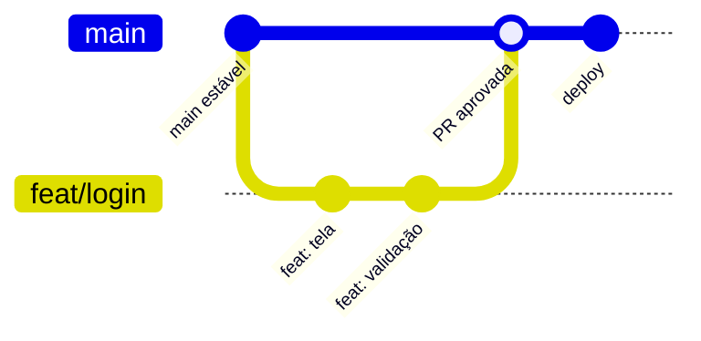
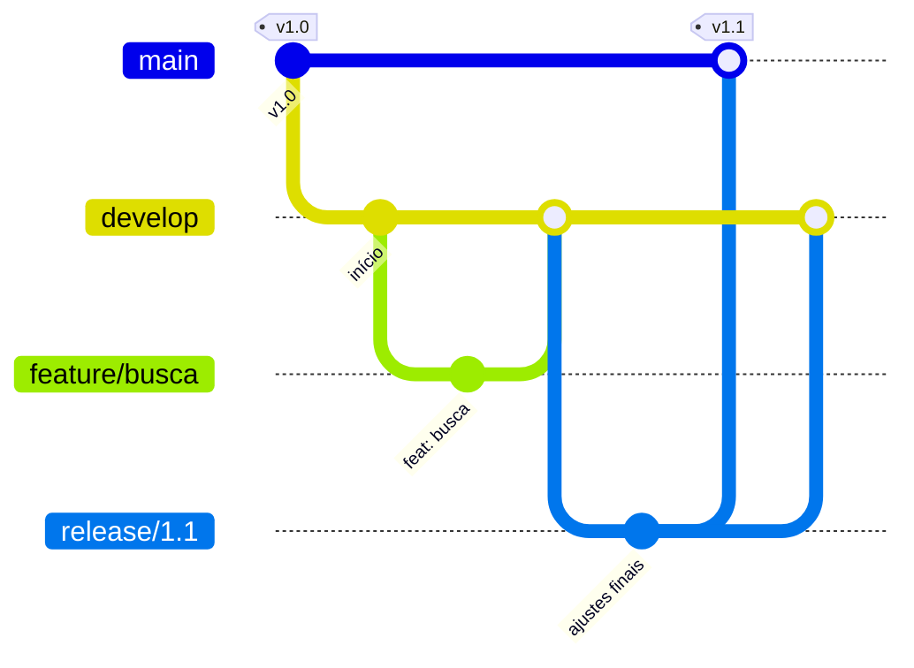
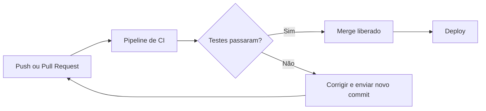

# Estratégias de Versionamento

> **Objetivo:** conhecer as principais estratégias de organização de branches usadas por equipes de software (GitHub Flow, Gitflow e Trunk-based Development), entender quando cada uma faz sentido e como elas se conectam com a Integração Contínua (CI).

---

## Para ambientar

Saber usar `git branch`, `git merge` e Pull Requests é só metade do caminho. Quando várias pessoas trabalham ao mesmo tempo, a equipe precisa combinar **como** vai usar as branches: quais existem, de onde nascem, para onde voltam e quando o código vai para produção.

Esse combinado é chamado de **estratégia de versionamento** (ou *branching strategy*). Não existe uma única certa, e a escolha depende do tamanho da equipe, da frequência de entregas e do tipo de produto.

---

## 1. GitHub Flow

É o fluxo mais simples e o mais usado em projetos modernos e em times que entregam com frequência. Tem **uma única branch permanente**, a `main`, que deve estar sempre pronta para ir à produção.

O ciclo é:

1. Criar uma **branch curta** a partir da `main`, com nome descritivo (`feat/04-sub-issue-01-conceitos`).
2. Fazer commits pequenos na branch.
3. Abrir uma **Pull Request** o quanto antes.
4. Passar por **code review** e pelas verificações automáticas.
5. Fazer o **merge** na `main`.
6. Fazer o **deploy** (publicação) e apagar a branch.



**Quando usar:** times pequenos e médios, aplicações web, entregas contínuas. É o padrão adotado nesta trilha.

---

## 2. Gitflow

É um modelo clássico, criado em 2010, com **várias branches permanentes** e papéis bem definidos:

| Branch | Tipo | Função |
| --- | --- | --- |
| `main` | Permanente | Guarda apenas versões já lançadas (cada uma marcada com uma tag) |
| `develop` | Permanente | Reúne o trabalho que está sendo integrado para o próximo lançamento |
| `feature/*` | Temporária | Nasce da `develop` para desenvolver uma funcionalidade e volta para ela |
| `release/*` | Temporária | Nasce da `develop` para preparar um lançamento (ajustes finais e testes) |
| `hotfix/*` | Temporária | Nasce da `main` para corrigir um problema urgente em produção |



**Quando é usado:** softwares com **versões lançadas em datas definidas** e várias versões mantidas ao mesmo tempo, como aplicativos instalados, bibliotecas e sistemas embarcados.

**Por que times modernos evitam o excesso:** com tantas branches de longa duração, o código demora para se integrar, os conflitos de merge crescem e a quantidade de "cerimônia" (release, hotfix, merge duplo em `main` e `develop`) atrasa as entregas. Para quem faz deploy várias vezes ao dia, esse peso quase nunca compensa.

> O próprio autor do Gitflow recomenda, em uma nota no artigo original, que times que fazem entrega contínua em aplicações web adotem fluxos mais simples, como o GitHub Flow.

---

## 3. Trunk-based Development

Aqui a ideia é ainda mais radical: todo mundo trabalha em cima de **uma única linha principal**, o *trunk* (na prática, a `main`). As branches, quando existem, são **ultracurtas** (de horas a no máximo um ou dois dias) e voltam logo para o tronco.

O desafio é integrar código ainda **incompleto** sem quebrar a produção. Para isso entram as **feature flags** (ou *feature toggles*): o código novo é enviado já desligado e só é ativado quando estiver pronto.

```python
if feature_flags.is_enabled("novo_checkout"):
    mostrar_novo_checkout()
else:
    mostrar_checkout_atual()
```

Vantagens: integração constante, poucos conflitos e entrega muito rápida. Em contrapartida, exige **bons testes automatizados**, uma cultura madura de revisão e disciplina com as flags (removê-las quando deixam de ser úteis).

---

## 4. Comparando as estratégias

| Característica | GitHub Flow | Gitflow | Trunk-based |
| --- | --- | --- | --- |
| **Branches permanentes** | 1 (`main`) | 2 ou mais (`main` e `develop`) | 1 (`main`/trunk) |
| **Duração das branches** | Curta (dias) | Variável (pode ser longa) | Ultracurta (horas) |
| **Frequência de deploy** | Alta | Planejada por release | Muito alta |
| **Complexidade** | Baixa | Alta | Baixa, mas exige maturidade |
| **Bom para** | Web, times pequenos e médios | Versões lançadas por datas | Times com CI/CD maduro |

---

## 5. Conexão com a Integração Contínua (CI)

A **Integração Contínua** consiste em rodar, **automaticamente**, build e testes a cada alteração enviada. No GitHub, isso costuma ser feito com o **GitHub Actions**.

A estratégia de branches define **quando** o pipeline roda e **o que** ele protege:

- No **GitHub Flow**, o pipeline roda em cada Pull Request e na `main`. Com uma **Branch Protection Rule** exigindo os *status checks*, o merge só acontece se os testes passarem.
- No **Gitflow**, é comum ter pipelines diferentes para `develop` (testes de integração) e `release/*` (testes completos e geração do pacote).
- No **Trunk-based**, o CI é o ponto central: como todos integram o tempo todo, um pipeline rápido e confiável é o que mantém o tronco sempre saudável.



---

## 6. Exemplo prático

Um time de 5 pessoas mantém um site que recebe atualizações toda semana. Qual estratégia escolher?

- O site tem **um único ambiente de produção** e sem várias versões convivendo.
- As entregas são **frequentes** e não dependem de datas fixas.

A escolha mais natural é o **GitHub Flow**: `main` protegida, branches curtas, Pull Request com revisão e CI obrigatório. Se o time crescer e o pipeline ficar muito confiável, vale evoluir para o Trunk-based com feature flags.

---

## Referências

- [GitHub Docs: GitHub Flow](https://docs.github.com/pt/get-started/using-github/github-flow)
- [Vincent Driessen: A successful Git branching model (Gitflow)](https://nvie.com/posts/a-successful-git-branching-model/)
- [Trunk Based Development](https://trunkbaseddevelopment.com/)
- [GitHub Docs: Sobre integração contínua com GitHub Actions](https://docs.github.com/pt/actions/about-github-actions/about-continuous-integration-with-github-actions)

---

[← Anterior: 05 - Code Review](../05-code-review/code-review.md) | [Próximo: 07 - GitHub Flavored Markdown →](../07-github-flavored-markdown/github-flavored-markdown.md)
