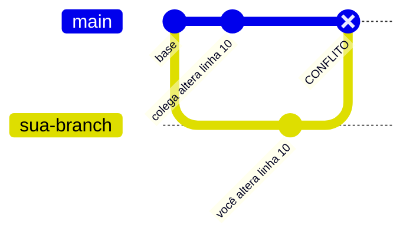
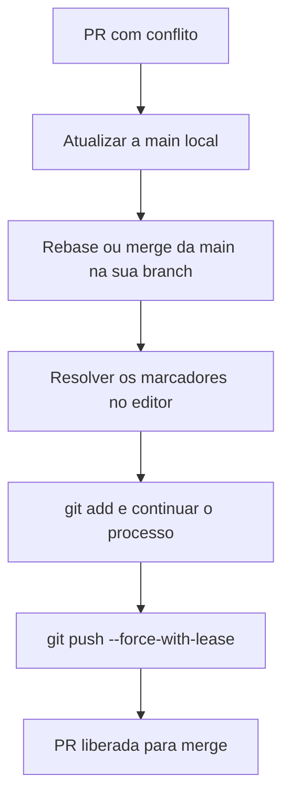

# Guia 05: Resolvendo Conflitos de PR no GitHub

> **Objetivo:** saber o que causa um conflito em uma Pull Request e resolvê-lo tanto pela interface do GitHub quanto pelo terminal, de forma segura e profissional.

---

## Cenário

Você abriu uma Pull Request e, em vez do botão verde de merge, aparece o aviso:

> **This branch has conflicts that must be resolved**

Isso acontece quando você e outra pessoa alteraram **as mesmas linhas** do mesmo arquivo, e o Git não consegue decidir sozinho qual versão manter. Não é um erro seu: é uma situação normal em trabalho em equipe.



---

## Abordagem Web (conflitos simples)

Indicada quando há poucos conflitos, em poucos arquivos.

1. Na Pull Request, clique em **Resolve conflicts**.
2. O GitHub abre um editor mostrando os **marcadores de conflito** (veja a seção abaixo).
3. Edite o arquivo e deixe apenas o conteúdo final, removendo os marcadores.
4. Clique em **Mark as resolved** e, depois de resolver todos os arquivos, em **Commit merge**.

> O botão **Resolve conflicts** só aparece para conflitos simples, em arquivos de texto. Em conflitos mais complexos (arquivos binários ou arquivos renomeados e removidos), é preciso usar o terminal.

---

## Abordagem Terminal (profissional)

É a mais completa, pois você resolve o conflito no seu editor de código, com acesso aos testes e a todo o contexto do projeto.

### 1. Atualizar a `main` local

```bash
git switch main
git pull origin main
```

### 2. Ir para a branch do PR e trazer as mudanças da `main`

Escolha **uma** das duas formas:

```bash
git switch feat/04-sub-issue-01-conceitos

# Opção A: rebase (histórico linear, reaplica seus commits por cima da main)
git rebase main

# Opção B: merge (cria um commit de merge e preserva o histórico como foi)
git merge main
```

O Git vai parar e avisar que existem arquivos em conflito. Para ver quais são:

```bash
git status
```

### 3. Resolver os marcadores no editor e salvar

Abra o arquivo em conflito. Ele terá este formato:

```text
<<<<<<< HEAD
conteúdo que veio da main (ou da base)
=======
conteúdo da sua branch
>>>>>>> feat/04-sub-issue-01-conceitos
```

| Marcador | Significado |
| --- | --- |
| `<<<<<<<` | Início do conflito, seguido da versão de um lado |
| `=======` | Separador entre as duas versões |
| `>>>>>>>` | Fim do conflito, com a versão do outro lado |

Decida o que fica: uma das versões, a outra ou uma **combinação** das duas. Depois **apague os três marcadores** e salve o arquivo.

> **Dica:** editores como o VS Code mostram botões como **Accept Current Change**, **Accept Incoming Change** e **Accept Both Changes** logo acima de cada conflito.

> Durante um `rebase`, os lados ficam "invertidos": o que aparece como `HEAD` é a `main`, e o que vem abaixo do `=======` é o seu commit. Leia com atenção antes de aceitar.

### 4. Continuar o processo

```bash
git add .
```

Depois, dependendo da opção escolhida:

```bash
# se você usou rebase
git rebase --continue

# se você usou merge
git commit
```

Se houver mais de um commit em conflito durante o rebase, repita os passos 3 e 4 até o Git finalizar. Para desistir e voltar ao estado anterior, use `git rebase --abort` (ou `git merge --abort`).

### 5. Subir a atualização com segurança

Como o `rebase` reescreve o histórico, o push normal será recusado. Use:

```bash
git push --force-with-lease origin feat/04-sub-issue-01-conceitos
```

> Prefira sempre `--force-with-lease` a `--force`. Ele só sobrescreve a branch remota se ninguém tiver enviado commits novos nela desde a sua última atualização, evitando apagar o trabalho de outra pessoa. Se você usou `git merge`, o push comum (`git push`) já é suficiente.

### 6. Confirmar a liberação do PR

Volte à Pull Request. O aviso de conflito desaparece e o botão de merge é liberado automaticamente. Confira também se os testes (status checks) rodaram novamente e aguarde a aprovação do revisor designado.



---

## Rebase ou merge: qual escolher?

| Critério | `git rebase main` | `git merge main` |
| --- | --- | --- |
| **Histórico** | Linear e limpo | Preserva o histórico, com commit de merge |
| **Push depois** | Exige `--force-with-lease` | Push comum |
| **Risco** | Maior, por reescrever commits | Menor |
| **Recomendado quando** | A branch é só sua | A branch é compartilhada com outras pessoas |

> **Dica:** combine com a sua equipe qual dos dois é o padrão. Se tiver dúvida, o `merge` é a opção mais segura para quem está começando.

---

## Exemplo prático

1. Você alterou o título do `README.md` na sua branch, e uma colega alterou a mesma linha na `main` e já fez o merge.
2. A sua PR mostra o aviso de conflito.
3. No terminal:

```bash
git switch main && git pull origin main
git switch feat/04-sub-issue-01-conceitos
git rebase main
# resolver o conflito no editor, remover os marcadores e salvar
git add README.md
git rebase --continue
git push --force-with-lease origin feat/04-sub-issue-01-conceitos
```

4. A PR é liberada e segue para a revisão.

> **Dica:** para reduzir conflitos, mantenha as PRs pequenas e atualize a sua branch com a `main` com frequência.

---

## Referências

- [GitHub Docs: Resolvendo um conflito de merge no GitHub](https://docs.github.com/pt/pull-requests/collaborating-with-pull-requests/addressing-merge-conflicts/resolving-a-merge-conflict-on-github)
- [GitHub Docs: Resolvendo um conflito de merge usando a linha de comando](https://docs.github.com/pt/pull-requests/collaborating-with-pull-requests/addressing-merge-conflicts/resolving-a-merge-conflict-using-the-command-line)
- [Git Docs: git-rebase](https://git-scm.com/docs/git-rebase)
- [Git Docs: git-push (--force-with-lease)](https://git-scm.com/docs/git-push)
