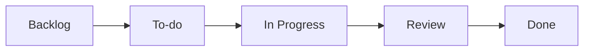
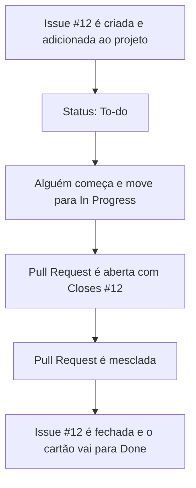

# GitHub Projects

> **Objetivo:** entender o que é o GitHub Projects, como organizar o trabalho em colunas e como os cartões se conectam a Issues e Pull Requests.

## Para ambientar

Em um repositório, o trabalho aparece em **Issues** (tarefas, bugs, ideias) e **Pull Requests** (propostas de alteração no código). Com o tempo, esses itens acabam se espalhando, e fica mais difícil saber o que está parado, o que está em andamento e o que já terminou.

É aí que entra o **GitHub Projects**. Ele nada mais é do que um painel que junta esses itens em um só lugar, mostrando o status e a prioridade de cada item, mesmo quando eles vêm de repositórios diferentes. Aqui o assunto é o Projects atual, que tomou o lugar dos Projetos clássicos. Mas quem pode ver e editar cada projeto varia a depender da organização e das equipes (Teams), que será um tema discutido no arquivo [04 - Organizations](04-github-organizations.md)
---

## 1. O que é o GitHub Projects

O GitHub Projects é o sistema de **gestão ágil** nativo do GitHub, baseado em **quadros Kanban** e **tabelas customizadas**. Kanban é um método visual em que o trabalho vira cartões, e os cartões andam pelas colunas de acordo com a etapa do processo.
[04 - Organizations](04-github-organizations.md)

Um mesmo projeto pode ser visto de três formas (layouts), sem duplicar os dados:

| Layout             | Para que serve                                                                   |
| ------------------ | -------------------------------------------------------------------------------- |
| **Tabela**         | Visão em linhas e colunas, boa para filtrar, ordenar e agrupar itens             |
| **Quadro (board)** | Visão Kanban, com cartões organizados em colunas, como mostrado no exemplo acima |
| **Roadmap**        | Linha do tempo, boa para planejar prazos e entregas                              |

---

## 2. Estrutura básica

No quadro, as colunas vêm do campo **Status**. Um fluxo clássico usa cinco colunas:

|Coluna|O que significa|
|---|---|
|**Backlog**|Ideias e tarefas ainda sem prioridade, guardadas para depois|
|**To-do**|Tarefas priorizadas e prontas para começar|
|**In Progress**|Tarefas que alguém está fazendo agora|
|**Review**|Trabalho pronto, aguardando revisão|
|**Done**|Trabalho concluído|

> ⚠️**PSIU!!!:** ao criar um quadro novo, o GitHub já traz três colunas prontas: **To-do**, **In Progress** e **Done**. Para ter também o **Backlog** e o **Review**, é só adicionar essas opções ao campo Status. E, se preferir outros nomes, cada coluna pode ser renomeada de acordo com a sua necessidade.

---

## 3. Integração nativa com Issues e Pull Requests

Os cartões do Projects não são cópias. Cada um é a própria Issue ou Pull Request vinculada diretamente ao projeto. Por isso, o que muda em um lado aparece no outro.

### Formas de adicionar itens ao projeto

1. **Colar a URL** da Issue ou Pull Request na linha de adicionar do projeto.
2. **Pesquisar** com `#` e escolher o repositório e o item.
3. **Adição em massa**, escolhendo vários itens de um repositório de uma vez.

### Movimentação automática (fluxos de trabalho)

O Projects tem **workflows integrados**, que atualizam o Status sozinhos quando algo acontece, seja no repositório ou no próprio projeto. Dois já vêm ligados assim que o projeto é criado:

- Quando uma Issue ou Pull Request é **fechada**, o cartão vai para **Done**.
- Quando uma Pull Request é **mesclada** (merged), o cartão também vai para **Done**.

Dá para ligar outros conforme a necessidade, como:

- colocar o status **To-do** assim que um item entra no projeto;
- fechar a Issue quando o cartão for movido para Done;
- trazer itens de um repositório automaticamente;
- arquivar os itens concluídos.

Todos eles ficam em **Projeto → ... → Workflows**.

### Exemplo do fluxo completo

> **Dica:** escrever `Closes #12` na descrição da Pull Request faz a Issue ser fechada sozinha quando a PR é mesclada. É isso que dispara o movimento do cartão para Done.

---
[[04 - organizations|Próximo: 04 - Organizations →]]
