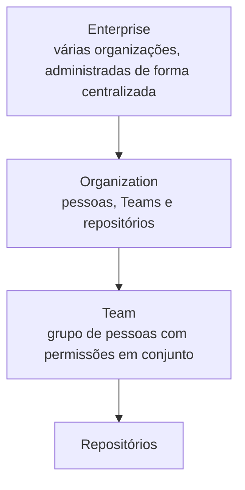

# GitHub Organizations

> **Objetivo:** entender o que são as Organizations, como elas se diferenciam das contas pessoais e como equipes e permissões controlam quem pode fazer o quê.

---

## Para ambientar

Todas as pessoas começam no GitHub com uma **conta pessoal**. Quando um grupo precisa trabalhar junto, com vários repositórios e vários responsáveis, ela deixa de ser suficiente. E é justamente aí que entram as **Organizations**.

A estrutura de administração do GitHub se organiza em camadas:

(Este arquivo foca em **Organization** e **Team**.)

---

## 1. O que são GitHub Organizations

Uma **Organization** é uma conta compartilhada, criada para reunir pessoas e repositórios em um mesmo espaço. É usada por:

- **Empresas**, para organizar os projetos e as equipes de desenvolvimento;
- **Iniciativas acadêmicas**, como o AWS Student Builder Group;
- **Comunidades**, como projetos open source mantidos por várias pessoas.

Um detalhe importante: ninguém "entra" na organização com um login próprio dela. Cada pessoa continua usando a sua conta pessoal, e a organização só define qual papel essa conta tem lá dentro, a depender do cargo da pessoa.

Os papéis dentro da organização são:

| Papel                    | O que faz                                                                                            |
| ------------------------ | ---------------------------------------------------------------------------------------------------- |
| **Owner**                | Controle completo da organização, incluindo membros, Teams, permissões e cobrança                    |
| **Member**               | Membro comum, que pode criar e gerenciar repositórios e Teams, conforme as permissões da organização |
| **Moderator**            | Modera a comunidade, como bloquear não membros e ocultar comentários                                 |
| **Billing manager**      | Cuida só das informações de cobrança                                                                 |
| **Security manager**     | Gerencia alertas e configurações de segurança                                                        |
| **Outside collaborator** | Pessoa de fora da organização que recebe acesso a repositórios específicos                           |

> ⚠️ **PSIU!!!:** a recomendação é ter **pelo menos dois Owners**, para que a administração não dependa de uma pessoa só.

---

## 2. Diferença de contas pessoais

| Característica | Conta pessoal | Organization |
| --- | --- | --- |
| **Quem é o dono dos repositórios** | A pessoa | A organização, como propriedade coletiva |
| **Mantenedores** | Um dono, que convida colaboradores um a um | Vários Owners e Members, com papéis definidos |
| **Faturamento** | Individual, ligado à pessoa | Centralizado, com plano próprio (Free, Team ou Enterprise) |
| **Permissões** | Por colaborador, repositório a repositório | Por papéis e por Teams, aplicados a vários repositórios de uma vez |
| **Se alguém sai** | Os repositórios continuam presos à conta dessa pessoa | Os repositórios continuam na organização |

Basicamente, a organização transforma o projeto em algo **coletivo**: ele não depende de uma única pessoa, e o custo, o acesso e a administração ficam em um lugar só.

---

## 3. Equipes e permissões

### 3.1 Teams

Uma **Team** é um grupo de pessoas dentro da organização, organizado por área, projeto ou função (por exemplo, `Front-end` ou `Data Science`). Em vez de dar acesso pessoa por pessoa em cada repositório, a organização dá acesso à Team inteira de uma vez.

Teams também podem ser organizadas em **parent e child teams**, em que a equipe filha herda as permissões da equipe pai. Dentro de uma Team, existem dois níveis: **Member** e **Maintainer** (este último pode gerenciar os membros e as configurações da Team).

Uma Team também pode ser vinculada a um projeto do GitHub Projects (como no arquivo [03 - GitHub Projects](03-github-projects.md)), e a equipe vinculada recebe permissão de leitura nesse projeto.

### 3.2 Níveis de acesso

Uma Team (ou uma pessoa) pode receber cinco níveis de permissão em um repositório:

| Permissão | O que permite |
| --- | --- |
| **Read** | Visualizar, clonar e comentar em Issues e Pull Requests |
| **Triage** | Gerenciar Issues e Pull Requests, sem enviar código |
| **Write** | Enviar alterações ao repositório, que é o nível comum para quem desenvolve |
| **Maintain** | Administrar o repositório, sem as ações mais sensíveis ou destrutivas |
| **Admin** | Controle total, incluindo segurança, configurações e exclusão do repositório |

Quando a mesma pessoa recebe acesso por várias fontes (diretamente e por uma Team, por exemplo), vale **o maior nível concedido**. O GitHub recomenda seguir o **princípio do menor privilégio**: dar só a permissão necessária para a pessoa fazer o seu trabalho.

### 3.3 Regras de proteção de branch (Branch Protection Rules)

As **Branch Protection Rules** protegem branches importantes, como a `main`, contra alterações diretas ou arriscadas. Entre as regras mais usadas:

- exigir **Pull Request** antes de qualquer alteração entrar na branch;
- exigir um número mínimo de **aprovações** (required reviews);
- exigir que **testes e verificações** (status checks) passem antes do merge;
- bloquear **force push** e a exclusão da branch.

Na prática, mesmo quem tem permissão de **Write** não consegue enviar código direto para a `main` protegida: o trabalho precisa passar por Pull Request e revisão.

> **Dica:** a disponibilidade das regras de proteção em repositórios privados depende do plano da conta.

---

[← Anterior: 03 - GitHub Projects](03-github-projects.md)
